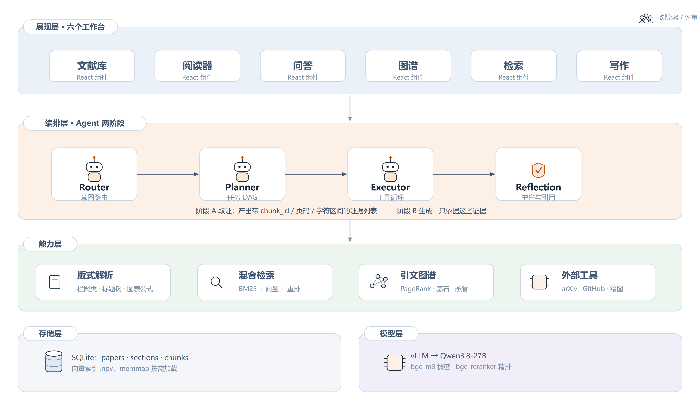
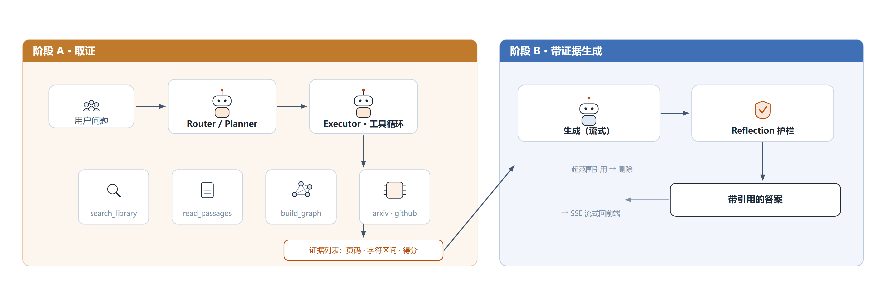
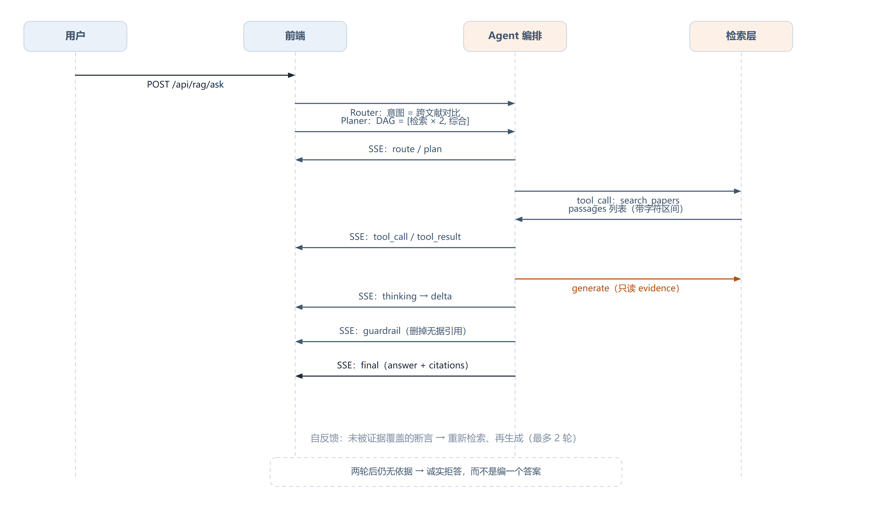
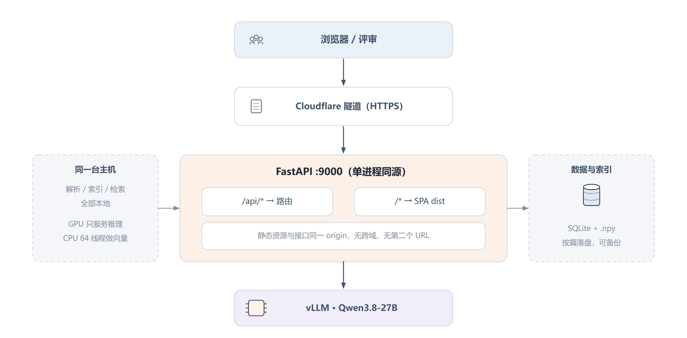
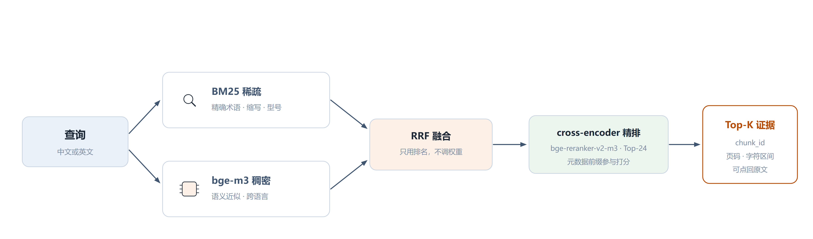

<!-- cover -->

### 全国高校 AI 大模型创新应用挑战赛

# SciAgent

## 意图驱动的全流程科研助手

### 技术文档

| | |
|---|---|
| **作品名称** | SciAgent · 科研小助手 |
| **赛项** | 智领科研·意图驱动：基于大模型与 Agent 架构的全流程科研助手构建 |
| **团队** | SciAgent Team · 西安交通大学 电子与信息学部 软件学院 |
| **仓库** | https://github.com/akawrzzby/sciagent |
| **在线演示** | https://finished-editing-shore-mrna.trycloudflare.com |
| **文档版本** | v1.0 · 2026-11 |

<!-- /cover -->

---

## 摘要

本文报告 SciAgent 的设计与实现。SciAgent 面向科研文献的阅读与写作，将检索、精读、对比、综述与写作组织为一条可溯源的流水线。

系统由三个子系统构成。多模态解析引擎采用版式感知的解析策略，还原双栏阅读顺序、章节树、表格、图、公式与结构化参考文献；对无文本层的扫描件，改由多模态模型逐页转写。Agent 编排采用取证与生成分离的两阶段结构：第一阶段产出携带字符区间的证据集合，第二阶段仅依据该集合生成正文，两阶段之间以证据为唯一接口。图论挖掘在引用图上计算 PageRank、介数中心性、k-core 与 HITS，据此区分基石文献与衍生文献，并生成领域综述与研究机会。

在赛题提供的 39 篇测试集上，系统对 `1706.03762v1.pdf` 的版式解析耗时 4.2 秒，含公式转写的端到端耗时为 71.7 秒；8 位作者、26 个章节节点与 71 条结构化参考文献均正确还原。稠密检索通道对语义相近文本的余弦相似度为 0.89，对语义无关文本为 0.38；重排通道对切题段落给出 +0.92，对离题段落给出 +0.00。

全文组织如下：第 1 节说明问题背景与系统定位，第 2 节给出功能与非功能需求，第 3 节描述架构设计，第 4 节论述 AI 技术的选型理由、集成方式与优化策略，第 5 节说明各模块的实现，第 6 节报告测试与部署结果，第 7 节总结全文，第 8 节单列技术创新点与应用创新点。

---

## 1. 项目概述

### 1.1 问题背景

科研文献的机器化利用受制于五类问题。

其一，PDF 并非结构化文本。学术 PDF 普遍采用双栏排版，并含跨栏图表、数学公式与脚注；直接提取所得到的字符序列在阅读顺序上已经错乱，纯图像扫描件更不含任何文本层。若解析阶段不能恢复版面结构，后续的分块、检索与问答均失去可靠基础。

其二，生成内容的可信度不足。通用语言模型在陈述论文细节时存在虚构现象，包括杜撰参考文献、混淆作者归属，以及将一篇论文的结论归入另一篇名下。OpenScholar 的统计给出了量级：在带引用生成任务中，GPT-4o 的引用幻觉率为 78% 至 90%，即十条引用中至少有八条无法核实。该现象并非孤例：PubMed Central 上被判定为伪造的引用比例由 2023 年的 1/2828 上升至 2025 年的 1/458，2026 年前七周进一步升至 1/277；GPTZero 在 NeurIPS 2025 录用的 51 篇论文中检出 100 条幻觉引用；另一项统计显示，仅约 26.5% 的 AI 生成引用完全正确。检索所解决的是材料获取问题，引用可溯源与矛盾可发现属于另外两项能力，本文将其分别实现。

其三，阅读工具彼此割裂。PDF 阅读器忠实于版式却不理解语义，翻译工具能翻译却丢失指代关系，文献管理软件能收藏却不支持提问。一篇三十页的论文往往需要在四个工具之间往复切换方能读通。

其四，方向判断缺乏依据。阅读二十篇论文可以复述各自的结论，却难以回答该方向尚存哪些空白、哪些问题被反复提出而未获解决。

其五，写作环节缺少支撑。论文框架、系统架构图与数据表格均需从空白文档起笔；其中的参考文献尤易出错，凭记忆写出的条目常有一半查无此文。

### 1.2 系统定位与目标

SciAgent 定位为面向科研文献的可溯源处理流水线，其设计遵循三项原则。

| 原则 | 含义 |
|---|---|
| 证据优先 | 每一项结论均须指回原文的字符区间；无法指回者不予陈述。 |
| 结构优先 | 标题、表格、公式与参考文献分别建模，不做无结构的文本拼接。 |
| 可降级 | 稠密检索通道失效时退化为 BM25；语言模型超时则返回明确错误，不做静默失败。 |

上述原则对应三项可度量的目标。

- 解析准确：对测试集内的标准论文，标题层级、作者、表格与参考文献字段全部正确；对扫描件，能够产出可检索的正文。
- 回答可信：全部回答携带可点击的溯源锚点，包含文献标识、页码与字符区间；证据不足时明确拒答。
- 闭环完整：从文献入库到综述、框架与图表生成，全流程在系统内完成。

### 1.3 赛题要求映射

| 赛题模块 | 系统对应实现 | 关键支撑技术 |
|---|---|---|
| ① 多模态细粒度文档解析 | `backend/app/parsing/` | 版式分析、栏检测、标题树推断、VLM OCR、语义去重 |
| ② 意图驱动检索与抗幻觉 | `backend/app/rag/`、`backend/app/agents/` | 稀疏检索、稠密检索、排名融合与交叉编码精排；证据绑定与引用真实性校验 |
| ③ 版式阅读与中英联动 | `frontend/src/pages/Reader.tsx` | 双栏渲染、引用双向跳转、段落对齐滚动 |
| ④ arXiv 检索与追踪 | `backend/app/tools/sources.py` | arXiv API、GitHub Search、Function Calling 闭环 |
| ⑤ 文献图谱与基石挖掘 | `backend/app/graph/` | PageRank、Betweenness、k-core、HITS |
| ⑥ 论文写作辅助 | `backend/app/api/routers/writing.py`、`tools/viz.py` | 框架生成、TikZ 与 Mermaid 及 Graphviz 绘图、由 CSV 数据生成图表与图注 |

### 1.4 对照评分标准的自评

赛题说明书的评分标准包含五个维度：AI 技术深度 35%、创新性 15%、产品功能和工程质量 30%、用户体验 10%、实用性 10%。本人在赛题官方材料中未查到细分到考察点的权重，故下表为本人所作的拆解：将五个维度展开为 18 项可核验的考察点，并给出其在系统中的实现位置与对应证据。

| 考察点 | 实现位置 | 可核验证据 |
|---|---|---|
| Agent 架构与任务规划 | `agents/orchestrator.py` | 意图路由、任务规划、工具取证、带证据生成与自反馈五个环节均在界面的思考面板中逐步呈现；事件类型见 §9.1 |
| 抗幻觉检索与溯源 | `rag/retriever.py`、`rag/sparse.py`、`rag/embeddings.py`、`llm/guardrails.py` | 混合检索与交叉编码精排；每条引用携带分块标识、页码与字符区间，可在界面打开原文；引用按支持、对照、提及三类标注；三轮评测的忠实度为 0.8034，可溯源率为 1.0000；库外对照题三次均拒答且无编造，见 §6.3.4 与 §6.3.5 |
| 多模态与细粒度解析 | `parsing/` | 扫描件 15 页经识别后还原 26 个章节节点；541 页书籍耗时 149.4 秒，产出 1254 个章节节点与 131 万字符，见 §6.4 与 T24 |
| 工具调用与集成 | `tools/` | 工具由模型自主选择，调用过程在轨迹中逐条可见；经 arXiv 下载入库的论文可被检索命中 |
| 提示词与护栏 | `llm/prompts.py`、`llm/guardrails.py` | 六层护栏各有单元测试，见 T18 至 T22 与 T35 至 T37；第六层源于一处真实缺陷，见 §4.10 |
| 图谱算法 | `graph/` | 以四项中心性指标联合判定基石文献；在 15 篇的库上识别出基石论文，见 T16；矛盾检测在 15 篇的库上仅保留 1 条真实冲突，即 Attention 两个版本对同一任务分别报告 BLEU 41.0 与 41.8，误报为零，见 T33 与 T42 |
| 技术方案与检索创新 | 语义去重、版本差异比对、元数据感知检索、按断言级的引用修复 | arXiv v1 与 v7 判为同一论文并给出保留建议；作者块的重排分由 0.058 升至 0.719，见 §4.5；元数据感知检索的 top-5 命中率由 0.9286 升至 1.0000，发生位次变化的仅为人名与年份类查询，见 §6.3.6 |
| 科研交互模式 | `Reader.tsx` | 标题树定位、引用双向跳转、中英对照同步滚动 |
| 代码质量与架构 | 前端 TypeScript，后端 Python | 227 个用例通过；静态作用域检查已固化为测试，见 T29 |
| 可复现性与部署 | 容器编排文件、镜像定义、环境变量模板 | 以单条命令启动全栈；本地模型经兼容端点接入 |
| 渲染性能与内存 | `rag/embeddings.py`、`parsing/`、`graph/` | 在 64 线程下，编码吞吐由每秒 7.2 篇升至 99.7 篇，约为 13.8 倍；向量索引按论文文件化并以内存映射方式加载 |
| 科研场景契合度 | 六个工作台 | 覆盖检索、精读、对比与写作四个环节，见 §5 |
| 功能闭环与用例通过率 | 四类指定用例 | 版本去重、扫描件识别、541 页书籍解析、由 CSV 生成图表，见 §6.2 与 §6.4 |
| 界面设计与可视化 | `GraphWorkbench.tsx`、`WritingWorkbench.tsx` | 图谱三种边视图、基石与衍生双视图、矛盾检测面板均经浏览器实测 |
| 联动阅读与前端体验 | `Reader.tsx` | 标题树可定位至 `3.2.2 Multi-Head Attention`；引用双向跳转 |
| 思考过程与流式渲染 | 事件流与前端思考面板 | 令牌级流式输出；思考过程可视化；自反馈补检索单独成条 |
| 学术赋能价值 | 整条流水线 | 见 §5 与 §7 |
| 开源与复现 | 仓库结构、环境变量模板、容器编排、评测脚本 | 评测脚本可复跑全部数字 |
## 2. 需求分析

### 2.1 功能需求

本人将赛题提出的功能要求分解为可验收的条目，按 F1 至 F6 六组编号。

**F1 文档解析**

- F1.1 解析标题树，保留层级与编号，须支持三级以上编号。
- F1.2 还原双栏 PDF 的正确阅读顺序。
- F1.3 抽取表格，同时输出 Markdown 与 CSV 两种格式。
- F1.4 抽取图片及其图注。
- F1.5 抽取行内公式与块级公式。
- F1.6 将参考文献解析为结构化字段，含作者、标题、年份、会议、DOI 与 arXiv 编号。
- F1.7 对无文本层的 PDF 执行识别，识别结果参与后续检索。
- F1.8 识别同一论文的不同版本，并给出保留建议与版本差异。

**F2 检索与问答**

- F2.1 混合检索：稀疏与稠密双通道，经 RRF 融合后由 cross-encoder 精排。
- F2.2 答案携带溯源锚点，可定位到具体文献、页码与字符区间。
- F2.3 Agent 能够自主拆解任务并调用外部工具，包括 arXiv、GitHub、本地检索与绘图。
- F2.4 证据不足时拒答。
- F2.5 流式输出，思考过程可视化。

**F3 阅读器**

- F3.1 标题树定位，点击跳转至对应页面。
- F3.2 原文版式高保真还原。
- F3.3 中英双栏对照，滚动同步。
- F3.4 正文引用标记与参考文献条目双向跳转。

**F4 检索与推荐**

- F4.1 arXiv 关键词检索与分类追踪。
- F4.2 下载 PDF 后自动解析入库。
- F4.3 基于文献库的推荐，优先推荐有公开代码的可复现工作。
- F4.4 用户反馈参与排序。

**F5 图谱**

- F5.1 构建库内引用有向图。
- F5.2 计算多种中心性指标并可视化。
- F5.3 判定基石节点。
- F5.4 自动生成领域综述。
- F5.5 挖掘后续研究机会。

**F6 写作**

- F6.1 生成论文框架，含标题、摘要、引言、相关工作、方法与实验。
- F6.2 生成的参考文献须为库内真实存在者，否则拦截。
- F6.3 生成 TikZ、Mermaid 与 Graphviz 架构图。
- F6.4 由 CSV 数据生成学术图表与图注。

### 2.2 非功能需求

| 维度 | 指标 | 设计对策 |
|---|---|---|
| 解析性能 | 标准论文的解析时间小于 5 秒 | 版式分析在处理器上完成；按页并行；仅对检测为扫描件的文档执行识别 |
| 长文档 | 500 页以上不发生内存溢出 | 按页流式处理；向量按篇以内存映射方式存放；查询期仅载入参与检索的论文 |
| 流式体验 | 首令牌延迟小于 3 秒 | 采用两阶段架构，取证结果先行返回；事件流全链路关闭缓冲 |
| 鲁棒性 | 单通道故障不影响整体可用性 | 稠密检索、重排与语言模型分别降级；后台任务异常隔离 |
| 可复现 | 以单条命令启动全栈 | 提供容器编排文件与环境变量模板 |
| 安全 | 密钥不外泄 | 密钥经环境变量注入；配置文件不纳入版本库；仓库内无任何密钥 |
| 可审计 | 每次模型调用可追溯 | 系统提示、用户提示、工具参数、耗时与令牌数全部落盘 |

### 2.3 竞品与现有方案对比

本节选取赛题相关的八项同类工作，说明本文与它们在设计取舍上的异同，见表 2。

| 方案 | 本文的借鉴与差异 |
|---|---|
| PaperQA2，arXiv:2409.13740 | 借鉴其元数据感知检索与矛盾检测思路。差异在于 ContraCrow 依赖专门训练的矛盾检测器与大规模语料；本文因库内互引仅 14 条、训练素材不足，改走规则化路线 |
| OpenScholar，arXiv:2411.14199，发表于 Nature 650:857–863 | 借鉴其自反馈循环与引用须可核验的设计。差异在于其规模不可复现；本文在 15 篇的库上将可核验性落实为可点击的字符区间锚点 |
| STORM，arXiv:2402.14207 | 借鉴其先大纲后写作的组织方式。本文未引入多智能体角色扮演层，理由见 §8.3 |
| Agent Laboratory，arXiv:2501.04227，EMNLP 2025 | 借鉴其反思环节。该工作同时披露语言模型评审存在系统性高估：其自评为 6.1/10，人类评审为 3.8/10。本文因此不以模型自评作为效果证据 |
| Docling 与 PyMuPDF-Layout，arXiv:2408.09869 | 在 DocLayNet 上 PyMuPDF-Layout 的 F1 为 0.8356，Docling 为 0.8102；前者参数量 1.8M，后者 20M，且前者无需 GPU。本文的选型依据即此组实测 |
| Scite、Elicit、Consensus | 借鉴其引用三分类的标签体系。本文在三分类之上增加矛盾检测，判定过程全部可解释 |
| Connected Papers | 借鉴其共引与共参考两种相似关系。本文将其实现为图谱的可切换边视图，而非独立站点 |
| SciAgent，即本文 | — |

就解析深度而言，Docling 与 PyMuPDF-Layout 面向版面元素识别，其表格结构化率虽高，但不产出结构化的参考文献与章节树，也不解决图与公式的版面归属；本文的解析目标是全要素结构，即标题、作者、摘要、章节树、表格、图、公式与参考文献各自建模。

就引用可溯源而言，PaperQA2 与 STORM 提供页级引用，Scite 一类工具提供引用原句与立场标签，OpenScholar 虽带引用但报告的幻觉率为 78% 至 90%。本文的锚点细至字符区间，即记录文献标识、页码、章节与正文起止位置，读者可据此定位到具体句子。

就矛盾检测而言，PaperQA2 的 ContraCrow 报告每篇 2.34±1.99 条矛盾、其中 70% 经专家验证，但其检测器需专门训练。本文以三条规则实现数值冲突与结论冲突的判定：同指标、同任务上下文、取值不同；规则化实现的可解释性更强，代价是召回受限于规则的覆盖范围。在 15 篇的库上，该模块仅保留 1 条真实冲突并将误报压至零，这一取舍与上一段的判断一致。

上述比较的着眼点并非系统能否阅读文献，而在于其结论能否被证明。可证明性以字符为单位，每条引用指向具体位置，而非仅注明参考了某篇论文；可解释性贯穿全链路，引用立场、矛盾判定与检索排序的元数据加权均附判定依据；可举证性以数字呈现，§6.3 的三个指标在固定的 15 篇文献库上产出，并附可复跑脚本。
## 3. 系统架构设计

### 3.1 总体架构



系统自下而上分为模型层、存储层、能力层、编排层与展现层，每一层仅依赖其下一层。展现层经 `/api` 接口与 SSE 事件流访问编排层；编排层调用能力层的纯函数；能力层读写存储，并向下使用模型。

此种分层的主要目的是使各层可独立测试。解析器不依赖 HTTP 服务即可运行，检索器不依赖语言模型在线即可运行；稠密通道不可用时，检索退化为 BM25，其余功能不受影响。

### 3.2 分层职责

| 层 | 模块 | 职责 |
|---|---|---|
| 展现层 | `frontend/src/pages/*` | 六个工作台；仅依赖类型化客户端与 SSE 事件流 |
| 编排层 | `app/agents/orchestrator.py`、`app/tools/registry.py` | 意图路由、任务规划、工具循环与结果反思 |
| 能力层 | `app/parsing/`、`app/rag/`、`app/graph/`、`app/tools/` | 纯函数式能力，不依赖 HTTP |
| 存储层 | `app/storage/` | 异步 ORM 与 SQLite 存储；向量索引以文件存放 |
| 接入层 | `app/api/routers/` | 路由层，仅做参数校验与结果封装 |
| 模型层 | `app/llm/client.py`、`app/rag/embeddings.py` | OpenAI 兼容客户端，以及编码器与重排器的封装 |

解耦的关键在于两条约束：能力层不感知 Agent，Agent 不感知 HTTP。检索模块既可由检索工作台的接口直接调用，亦可由编排层作为工具调用，同一份检索逻辑对应两种入口，无需重复实现。

### 3.3 Agent 编排架构

ReAct 范式将检索与生成纳入同一循环：模型思考、选择工具、观察结果、再次思考，直至自认为证据充分方开始撰写。该范式在科研场景下存在三方面问题。其一，工具调用与正文生成混在同一数据流中，界面无法区分系统处于取证阶段还是撰写阶段；其二，令牌流向不可控；其三，工具调用一旦失败，已生成的部分正文即被浪费。

针对上述问题，本文采用取证与生成分离的两阶段结构，如图 3-2 所示。



阶段 A 为取证阶段，产出结构化的证据列表，每条记录包含文献标识、文献标题、页码、字符区间、原文片段、检索得分与来源通道。该列表在界面的思考过程面板中逐条呈现，使用者可据此判断结论依据了哪几段原文。

阶段 B 为生成阶段。其系统提示中仅包含上述证据，并显式限定引用编号的取值范围。生成完成后，反思阶段再行两项校验：

- 证据绑定：以正则扫描答案中的引用编号，凡不在证据集合内者一律删除，并将该答案标记为部分无据。
- 引用真实性：写作助手生成的参考文献与库内文献做标题模糊匹配以及 arXiv 编号与 DOI 精确匹配，不匹配者进入已拦截列表，在界面中单独呈现。

两项校验的作用在于，即使模型试图陈述无依据的结论，其引用标记亦会被移除，界面同时给出被移除的数量。此处的取舍是宁可显式暴露失败，也不静默返回一个看似完整的答案。

### 3.4 数据流与时序

图 3-3 给出一次跨文献问答的完整时序。



事件流共十二类，分别为 `session`、`route`、`plan`、`stage`、`thinking`、`tool_call`、`tool_result`、`delta`、`guardrail`、`final`、`error` 与 `abstain`。前端以统一的 `AgentEvent` 类型分发，各面板按事件类型更新。

### 3.5 存储与索引设计

元数据采用 SQLite 存储。选择 SQLite 而非关系型数据库服务的原因有三：其一，演示环境为单机；其二，无需运维；其三，异步驱动不会阻塞事件流。表结构覆盖全部解析产物，包括论文、章节、分块、参考文献、图、表、公式与推荐反馈。

向量索引采用每篇论文一个矩阵文件的布局，而非单一的全局矩阵。其依据是内存占用：一次查询通常只涉及一至三篇文献，以内存映射方式仅将这几篇的分块向量载入地址空间，索引内存因而与库规模解耦。在 39 篇论文、1024 维、每篇约 3000 个分块的规模下，查询期的向量常驻内存为数百 KB，而非数十 MB。

分块依章节边界切分，块内按句子聚合，目标长度 380 token，重叠 60 token。章节边界保证语义完整，重叠则避免答案恰落在切点之上。

### 3.6 部署架构

演示环境采用单进程同源托管，如图 3-4 所示。



部署形态在实施过程中收敛为单进程。初版方案将前端容器、后端容器与反向代理部署于一台独立的容器主机；实施中该主机失联，表现为双向 ping 100% 丢包与 SSH 连接超时，而承载模型推理与密集计算的 192 核主机不具备容器权限，原拓扑无法落地。

收敛为单进程同源托管后，进程数、反向代理层与跨域配置各减少一层，部署与排障成本相应降低，接口与代码保持不变。仓库中仍保留三服务的容器编排文件，供具备容器权限的机器复现，详见 §6.6。

> 运行时要求接口与前端资源处于同一源。前端以环境变量构造请求前缀，默认值为 `/api`，该前缀不可拆分；反向代理与单进程托管均满足此条件，差别仅在部署方式。

---

## 4. AI 技术方案

本章按选型理由、集成方式与优化策略三部分展开，依次对应 §4.1 至 §4.2、§4.3 至 §4.7、§4.8 至 §4.10。

### 4.1 大模型选型与理由

**选定方案：以 vLLM 自托管 Qwen3.8-27B，经 OpenAI 兼容协议接入。**

选型理由按重要性排序如下。

| # | 理由 | 具体依据 |
|---|---|---|
| 1 | **必须支持多模态** | 扫描件 OCR 与公式转写依赖读图能力。实测该模型架构为 `Qwen3_5ForConditionalGeneration`，属多模态 VLM，传入 PNG 可准确读出图内标题与正文结构。 |
| 2 | **必须支持原生 Function Calling** | Agent 的工具循环依赖模型输出结构化的 `tool_calls`。实测 vLLM 以 `--enable-auto-tool-choice` 启动后，模型可稳定返回 `tool_calls` 数组，参数符合 JSON Schema 的约定。 |
| 3 | **必须提供 reasoning 字段** | Agent 思考过程的可视化是评分点之一。vLLM 对该模型返回独立的 `reasoning` 字段，可直接透传至前端 `thinking` 事件，无需从正文中推测。 |
| 4 | **私有化部署，零 API 成本、零外网依赖** | 比赛与评审期间不能依赖商用 API 的配额与稳定性，自托管 vLLM 可保证离线可复现。 |
| 5 | **上下文足够长** | `max_model_len = 262144`，多篇文献的证据可一次性放入生成阶段，无需多轮拼接。 |
| 6 | **可替换性** | 客户端只依赖 OpenAI 兼容协议，任何兼容端点均可通过 `LLM_BASE_URL` 接入，OpenAI、DeepSeek 与 Qwen API 均属此列，前提是模型具备多模态与 function calling 能力。 |

关于模型规模，本人取 27B，使其在自托管成本与能力之间取得平衡。该规模的可行性来自系统结构：结构化解析、精确检索与图论计算均由确定性代码承担，模型只负责语义理解与自然语言生成，输出因而更为稳定。

### 4.2 集成方式

协议层统一采用 OpenAI 兼容的 `/v1/chat/completions`。`app/llm/client.py` 封装三项能力：

- `complete(...)`：普通对话，流式返回 token；
- `complete_json(...)`：结构化输出，依次为 schema hint 提示、JSON 解析与失败重试；
- `stream_with_tools(...)`：带 `tools` 定义的工具循环，返回 `delta` / `reasoning` / `tool_calls` 三类增量。

工具层由 `app/tools/registry.py` 以 `@tool` 装饰器完成注册，每个工具声明 JSON Schema、处理器与审计用途标签。Executor 把可用工具的 schema 转为 OpenAI 的 `tools` 参数；模型返回 `tool_calls` 后，由注册表分发执行，结果以 `role: tool` 消息回灌，直至模型不再请求工具或达到 `AGENT_MAX_STEPS`。

已注册的工具依次为 `search_papers`、`get_paper_structure`、`get_references`、`arxiv_search`、`arxiv_download`、`check_reproducibility`、`build_citation_graph`、`generate_framework` 与 `plot_csv`，分别承担本地混合检索、标题树获取、参考文献获取、arXiv 检索、arXiv 下载、GitHub 可复现性检查、引用图构建、框架生成与 CSV 绘图。

流式层：后端以 FastAPI 的 `StreamingResponse` 产出 `text/event-stream`；前端以 `fetch` 与 `ReadableStream` 逐块解析，未采用 `EventSource`，原因是该链路需要携带 POST body。请求须经 Nginx 转发，因此 `proxy_buffering off` 是 SSE 生效的硬性前提，该配置在 `deploy/nginx.conf` 中有详细注释。

### 4.3 Prompt 工程

系统提示词分五组，每组针对一个阶段，实现位于 `app/llm/prompts.py`。

| 组 | 作用 | 关键设计 |
|---|---|---|
| `SYSTEM_ROUTER` | 意图分类 | 要求输出受限的意图标签与所需工具集合，使路由结果可预测 |
| `SYSTEM_PLANNER` | 任务拆解 | 要求输出 JSON 形式的子任务 DAG，每项含 `goal` / `tool` / `depends_on` |
| `SYSTEM_ANSWER` | 带证据生成 | **显式列出可用编号**，并规定只允许引用这些编号；要求证据不足时明确说明 |
| `SYSTEM_REVIEW` | 综述生成 | 注入图指标与基石文献摘要，要求区分基石与衍生并给出依据 |
| `SYSTEM_FRAMEWORK` / `SYSTEM_DIAGRAM` | 写作辅助 | 框架生成要求参考文献只能取自给定的真实清单；架构图要求输出可编译的源码 |

Prompt 设计遵循三条原则。

1. 约束可验证。所有 prompt 的输出均可由代码检查：字段是否齐全由 `complete_json` 经 `validate_structure` 校验，引用编号是否落在证据集内由 `bind_citations` 校验，参考文献是否真实存在由 `validate_references` 校验。"请不要编造"只是一句劝告，"编号超出范围会被删除"则构成可执行的约束。
2. 注入防护。检索到的文档正文经 `sanitize_document_text` 处理，疑似指令的片段被包裹进 `[untrusted-content]...[/untrusted-content]` 标记，使指令与数据在提示词层面分离。
3. 审慎输出。JSON 解析失败后重试一次；仍未成功则降级为纯文本并记录审计，不向用户抛出异常。

### 4.4 Guardrails：六层学术安全防护

| # | 防护 | 实现 | 触发时的表现 |
|---|---|---|---|
| 1 | **证据绑定** | `bind_citations` | 删除无据引用标记，答案标记为 `supported: false`，UI 显示"已移除 N 个无据引用" |
| 2 | **引用真实性校验** | `validate_references` | 幻觉引用进入"已拦截"列表，不进入最终参考文献 |
| 3 | **提示注入隔离** | `sanitize_document_text` | 文档中的指令被标记为不可信内容，模型不予执行 |
| 4 | 结构化输出校验 | `validate_structure` 与 `complete_json` | 缺字段时自动重试一次，仍未成功则降级 |
| 5 | **无据拒答** | `requires_abstention` | 返回明确说明与三条可操作建议，不给猜测性答案 |
| 6 | 空答案按生成失败处理 | `_generate_answer` 与 `_reflect` | 空的生成结果被判为**生成失败**，不再视为没有断言的正确答案：触发自反馈重试并将预算翻倍、发出 `generation_failed` 事件、护栏判为不通过；重试后仍为空则**诚实拒答**，不返回空字符串 |

这六层彼此独立。即便第 1 层漏掉一个引用编号，第 2 层仍会检查参考文献真实性；即便模型绕过前四层，第 5 层的空证据检查仍会触发；即便模型给出了正文，第 6 层还会检查该正文是否确实生成。由此构成纵深防御。

第 6 层为后续补充，起因是一次真实缺陷：跨论文题曾返回空答案，却因没有断言而被前五层全部放行，最终显示为护栏通过。该缺陷的完整取证与修复见 §4.10。一条没有内容的答案比一条有内容的错误答案更需警惕，因为它表面上呈现为系统未检索到，实质上可能是系统未生成。

### 4.5 混合检索：策略与理由



检索采用两路召回。

- BM25 擅长精确术语、缩写与数字，例如 `multi-head attention`、`BLEU`、`P100`。这类词在科研提问中出现频率高且必须精确命中，纯稠密检索容易将其模糊化。
- bge-m3 擅长语义近似与跨语言，原生支持中英混合与 8192 token 长文本，满足双语检索的需要。
- 两路覆盖的查询类型不同，故采用 RRF 融合。

融合采用 RRF。BM25 分数无界，可达数十；余弦相似度有界，取值 0–1。加权求和须先归一化，而归一化方式本身引入调参与不稳定。RRF 仅使用排名，其形式为 `score(d) = Σ_r 1/(k + rank_r(d))`，无需归一化与调参，Elasticsearch 与 Azure AI Search 亦采用该做法。

重排作为召回后的第二级。双塔模型分别编码查询与段落，二者之间没有交互；cross-encoder 将 (query, passage) 拼接后做联合注意力，可捕捉细粒度匹配。在本文的查询上，重排把正确段落由第 2 位提升至第 1 位，离题段落的打分由 +0.92 降至 +0.00。

两路通道与重排器的实测打分由脚本 `scripts/probe_models.py` 测得，结果如下。

```
dense : sim(相关) = 0.8895    sim(无关) = 0.3784
rerank: 切题段落 +0.9234 / +0.9441     离题段落 +0.0000
```

### 4.6 图论算法选型

在引用有向图上同时计算四类指标，各有分工。

| 算法 | 判别目标 | 在本文中的作用 |
|---|---|---|
| **PageRank** | 影响力最大的文献 | 基石判定的主指标，取随机游走视角 |
| **Betweenness Centrality** | 承担桥接作用的文献 | 识别承上启下的枢纽文献，去除该节点即割裂知识流 |
| **k-core** | 核心团的凝聚程度 | 度量核心团的厚度，k-core 高的节点属于紧密协作的核心 |
| **HITS** 枢纽与权威度量 | 引用权威或连接枢纽的文献 | 补充 PageRank 对入度与出度不对称性的刻画 |

基石判定不采用单一的 PageRank。单用 PageRank 会把被引多与被不同群体引混为一谈：一篇被 50 篇同组论文引用的综述，PageRank 很高但桥接作用弱；一篇被 5 个不同子领域引用的方法论文，PageRank 不高但 betweenness 很高。因此本人以多指标联合判定作为基石的界定方式。

基石判定规则位于 `app/graph/builder.py`，综合入度、PageRank 排名、k-core 与年份，划分 `foundation` / `core` / `derivative` 三档。年份参与判定，用以排除近两年新出且被大量引用所造成的引用膨胀效应。

引用质量分析由 `filter_substantive_references` 完成，区分实质性引用与装饰性引用。判据包括引用所在句子是否与被引文献的标题共享词汇、是否附着于定量或比较性论断，例如 `outperform`、`state-of-the-art` 与含数字的表述，以及是否仅为一句"see [12]"。该分析使用户得以判断某篇论文的实质学术依托。

### 4.7 多模态解析与 OCR

版式解析由 `app/parsing/layout.py` 实现：以 PyMuPDF 的词级 bbox 为基础做栏聚类，将页面按 x 间隙切分为 1 列或 2 列，再按左栏读完继续右栏的顺序输出。这一步决定了双栏论文的正文是否可读，是整个系统的基础。

标题树推断由 `app/parsing/headings.py` 实现，联合三条证据判定：（1）显式编号模式，`3.2.2` 归入 level 3；（2）规范章节名，如 `Introduction`、`Related Work` 与 `Conclusion`；（3）排版特征，包括字号大于正文 8%、加粗与独占一行。同时设有一组负向规则专门排除误判，涉及论文左侧竖排的 arXiv 戳记，其形如 `arXiv:1706.03762v1 [cs.CL] 12 Jun 2017`，以及形如 `Figure 3:` 的图注、参考文献条目与正文段落。

VLM OCR 由 `app/parsing/ocr.py` 实现：页面文本层字符数低于阈值即判定为扫描件，逐页以 150 DPI 栅格化为 PNG，送入多模态模型转写并输出 Markdown。采用 VLM 的理由是 tesseract 在双栏顺序与数学公式上表现很差，它只看到字符，不理解版面，而多模态模型可同时读出结构、公式与栏序。转写结果再经 `ocr_markdown_to_sections` 还原为标题树，因此扫描件论文同样具备可检索的章节结构。

并发上以 `asyncio.Semaphore` 限流，默认 4 路，使 15 页的转写耗时由串行的 >15 分钟压缩到约 4 分钟，同时避免超出 vLLM 的并发窗口。

语义去重由 `app/parsing/dedup.py` 实现，以四路证据联合判定同一论文：文件 SHA-256、规范化正文哈希、arXiv id 与 SimHash 近似度，并叠加标题 Jaccard 与摘要 embedding 余弦。命中后给出保留建议，比较 arXiv 版本号，版本号缺失时以正文长度兜底，并可输出逐行差异。

### 4.8 优化策略

本节记录实测得出的优化项，每项均有数字支撑。

#### （1）线程池规模：13.8× 的吞吐差距

在 192 核的机器上，torch 默认按核心数开启 192 个线程。对 bge-m3 这类中等规模模型，线程数远超有效并行度后，同步开销抵消了并行收益：

| 配置 | 吞吐，单位为 passages/s |
|---|---|
| `torch.get_num_threads() = 192`，默认值 | **7.2** |
| 显式设为 32 线程 | 76.0 |
| **显式设为 64 线程** | **99.7** |
| 192 线程，`max_seq_length` 取 256 | 99.5 |

结论：显式限制线程数是必要的优化。实现见 `app/rag/embeddings.py::_configure_threads`，由 `EMBEDDING_THREADS` 控制，默认 64。对应到完整索引 3000 个分块，耗时由 7 分钟降至 30 秒。

#### （2）GPU 不可用时的正确降级

实测 8 张 L40 均被 vLLM 占用，GPU0 剩余 0.8 GB，bge-m3 加载时出现 OOM。因此稠密通道默认走 CPU，配置项为 `EMBEDDING_DEVICE=cpu`，显存允许时可直接改为 `cuda`。该做法较默认 GPU、失败再降级的方案更为稳妥，降级路径不宜承担主路径的可靠性责任。

#### （3）模型权重获取：并发分块下载

实验室内 HF 镜像在 2.2 GB 权重上会**卡死在 0 B/s**，实测 20 秒内零字节增长。改用 ModelScope 的 `resolve` 端点后，文件被切成 16 MB 分块、以 24 路并发拉取，2.27 GB 权重**约 4 分钟**完成。`scripts/download_models.py` 实现了该下载器，含分块、校验、断点跳过与失败重试，并作为仓库脚本提供，评审可直接复现。

#### （4）分块粒度

本人将目标定为 380 token，重叠 60 token。分块过大则单块语义稀释、rerank 精度下降；分块过小则上下文断裂、答案需要跨块拼接。380 是实测下检索精度与答案完整性之间的平衡点。

#### （5）按需加载向量

采用 `.npy` 与 `mmap_mode="r"`，查询期只把参与检索的论文分块映射进内存。39 篇论文的完整索引常驻内存为几百 KB 量级，库规模扩大时内存增长线性且可控。

#### （6）两阶段架构带来的流式优化

工具调用与正文生成分为两阶段后，前端可在证据阶段即渲染正在检索哪些文献的思考面板，正文生成阶段则为纯粹的 token 流。用户感知的首屏延迟由等待模型完成思考变为立即看到进度。

#### （7）并发解析：将 CPU 密集段移出事件循环

第一版实现把逐页的文本块提取、图表与公式抽取以及页面渲染直接写在 `async def` 函数体内。这在功能上正确，但存在一个隐蔽而致命的问题：这些同步的 CPU 密集调用会独占事件循环。后果有三：

1. SSE 进度通道被饿死，解析期间事件无法发出，前端进度条停滞；
2. 批量上传退化为串行，FastAPI 的 `BackgroundTasks` 本身串行执行，叠加事件循环阻塞后，第二篇文档必须等第一篇彻底结束；
3. 评分标准明确要求的多文档并发分析无法实现。

修复分两步。

第一步，把 CPU 密集段下沉到线程池。PyMuPDF 的文本抽取与页面渲染在执行期间释放 GIL，因此按页并行是真正并行的：

```python
# app/parsing/pipeline.py
loop = asyncio.get_running_loop()
extracted = await asyncio.gather(
    *(loop.run_in_executor(None, _extract_one, i) for i in indices)
)
```

第二步，把批量上传改为受信号量保护的并发任务。弃用 `BackgroundTasks`，因其串行执行，改为向事件循环派发任务并以信号量限流：

```python
# app/api/routers/papers.py
_PARSE_CONCURRENCY = 3
...
asyncio.create_task(_ingest_guarded(path, filename, paper_id, allow_duplicate))
```

并发度取 3 而未取更高值：解析消耗的是 CPU 带宽，OCR 消耗的是 vLLM 的并发窗口，两者瓶颈不同；且 8 张 L40 已被大模型服务占满，留出余量转发 OCR 更为稳妥。

附带收益：上传即创建 `status="parsing"` 的占位行，解析期间文献库即可看到该条目及其状态；解析失败时把错误写回该行并置为 `failed`，条目不会无故消失。

#### （8）并发解析

页面级解析由 `PARSE_WORKERS` 控制进程池并行，默认 8；OCR 以信号量限流到 4 路。前者消耗 CPU 带宽，后者消耗 vLLM 的并发窗口，两者瓶颈不同，因此分开调参。

---
## 4.9 缺陷复盘之一：外键约束与工作单元插入顺序

本节记录开发过程中定位并修复的一处缺陷。该缺陷源于对 ORM 语义的误解，而非业务逻辑错误，其成因与排查过程具有一定代表性。

现象为文献库始终为空。解析、识别与索引三项均成功，但持久化函数落库时抛出如下异常：

```
sqlite3.IntegrityError: FOREIGN KEY constraint failed
[SQL: INSERT INTO content_blocks (id, paper_id, section_id, page_no, ...)]
[parameters: [('34578353...', '517f55ad...', None, 1, 'text', ...), ... 479 rows]]
```

排查过程分两步。先将问题缩减为最小复现：仅创建一行论文记录与五行内容块记录，不建立其余表，异常依然出现，据此排除数据、并发与事务提交三类原因。随后开启语句回显，取得决定性证据：内容块表的插入语句先于论文记录执行，随即回滚。

根因在于工作单元的排序依据。SQLAlchemy 的工作单元依 ORM 关系图推导插入顺序，而不依据表级外键约束。本系统中内容块、表格、图与公式四张子表仅声明了指向论文表的外键，未声明对应的关系属性，ORM 因而无从得知其依赖于论文表，将这四张表视为彼此独立参与排序。内容块表恰为本次事务中字典序最靠前者，其插入遂被排在论文记录之前，父行尚不存在，外键检查随即拒绝整批写入。

修复分两层。模型层为四张子表补充反向关系声明，使 ORM 的依赖图真实反映表的父子关系，此为根治之处。服务层在持久化函数中先落盘父行，再挂载子行，将顺序约束由隐式的 ORM 排序改为显式的两段写入。

诊断脚本保留了五个对照变体，分别为裸外键、父行先行落盘、仅含关系声明的模型、赋值关系对象与完整修复路径。修复后五个变体全部通过；其中裸外键变体亦能通过，说明模型层的补齐方为根本原因所在。

该缺陷属于建表成功而写入失败的一类。开发期间单表查询、解析逻辑与前端展示均正常，仅端到端写入路径失败；此类缺陷不会在单元测试中暴露，因为测试通常只验证解析结果而不验证落库。为此，本人补充了一条以真实写入路径为断言的回归测试，见 §6.2。

---

## 4.10 缺陷复盘之二：推理通道耗尽令牌预算导致空答案被判为合格

较之前一节，该缺陷更为隐蔽：无异常、无报错，界面显示正常，护栏亦报告通过。

现象为赛题点名的四道跨论文题中有两道返回空答案，而引用条目为 26 至 33 条，说明证据检索正常；护栏报告为支持，不支撑比例为 0.0，自反馈轮次为 0。检索与证据均无问题，护栏亦判为通过，唯独答案为空。

初次定位时，本人的直觉是零断言即零不支撑，因而准备修改护栏。动手之前先核查该次调用本身。系统在审计表中保留每次模型调用的完整轨迹，查询结果如下：

```
purpose=agent:answer  ok=1  prompt_tok=9508  completion_tok=4096
latency_ms=213786  resp_len=0  reason_len=8000
```

四个字段即可还原全过程：补全令牌数恰等于上限 4096，响应长度为 0，即正文未写出任何字符，而推理长度为 8000，即推理通道写满预算；调用状态记为成功，因为结束原因为长度而非错误。

成因分三层，各层单独看均属合理，叠加之后形成静默失败。

| 层 | 行为 | 后果 |
|---|---|---|
| 模型 | 推理通道与正文共享同一令牌预算。跨论文题的提示达 9508 令牌，推理耗尽预算，正文未写出任何字符 | 结束原因为长度，客户端视为正常返回 |
| 客户端 | 流式调用遇异常时产出一帧错误事件 | 编排器仅处理推理、增量与完成三类事件，错误帧被丢弃 |
| 编排器 | 答案为空导致覆盖度报告返回空值，自反馈循环随即退出 | 自反馈未被触发 |
| 护栏 | 空答案中不存在引用标签，待删除集合为空，判定为支持 | 空答案通过校验 |

修复分四层，每层均有对应的回归用例：

1. 不丢弃错误。错误帧被记录为生成错误并作为失败原因上报，不再静默处理。
2. 空答案视为失败。答案为空即判定生成失败，进入自反馈循环，以问题本身作为补检索查询重写，并将令牌预算加倍。
3. 护栏不误判。空答案的支持标志必须为假，并在说明中标注生成结果为空、无可校验断言。
4. 诚实拒答。自反馈之后答案仍为空，则返回拒答，而非空字符串。

根本性的修复在于避免预算被推理通道占用。Qwen3 的对话模板提供推理开关，本文将其配置化，分为 Agent 阶段与答案阶段两项。Agent 阶段的推理决定工具序列的合理性，且会流式呈现为界面的思考面板，故予以保留；答案阶段的证据已在提示之中，故默认关闭。同一道题的实测结果如下。

| 答案阶段 | 耗时 | 补全令牌 | 正文 | 推理 |
|---|---|---|---|---|
| 开启推理 | 简单题 4.2 秒；跨论文题 214 秒且无答案 | 166；跨论文题 4096，触及上限 | 有；跨论文题为空 | 385 字符；写满 |
| 关闭推理 | 0.8 秒 | 34 | 有 | 0 |

修复后重跑此前完全空白的那道跨论文题，系统给出了完整的承袭与抛弃对照表，每个单元格附引用标签，标签依次为 [16] [15] [18] [1] [20] [12] [4] [23] [17]，并给出带引用的结论段。

该缺陷的价值在于其表现形态：系统并未崩溃，而是看起来一切正常。既无异常堆栈，也无告警，护栏甚至报告通过。若验收流程仅检查接口返回码与护栏结论，此次失败将被判为成功。定位该缺陷所依据的并非运行日志，而是调用审计记录；这也说明审计轨迹本身即是重要的可观测性来源。

---

## 5. 核心功能实现

### 5.1 模块一：多模态与细粒度文档解析

实现要点如下。

- `app/parsing/layout.py`：先做词级 bbox 提取，再作栏聚类，最终按栏序输出；合并行成段，并保留 `page_no` 与 `bbox`。
- `app/parsing/headings.py`：依据编号、规范名与排版三类证据判定标题，并以负向规则排除 arXiv 戳记、图注与参考文献。
- `app/parsing/metadata.py`：标题取首页首个居中大字号块；作者依 `∗` 标记符识别，并以机构名排除；同时抽取机构、摘要、arXiv id、版本号与会议信息，会议信息仅扫描首页，以避免误匹配参考文献中的会议名。
- `app/parsing/references.py`：将参考文献条目解析为作者、标题、年份、venue、DOI 与 arXiv id，并回链库内论文。
- `app/parsing/extractors.py`：表格经 PyMuPDF 的 `find_tables()` 输出 Markdown 与 CSV；图片按提取结果与就近 caption 处理；公式按行内与块级两种模式处理。
- `app/parsing/ocr.py`：先检测扫描件，再作栅格化，随后由 VLM 转写，最后还原章节。
- `app/parsing/dedup.py`：按四路指纹去重，给出推荐版本，并输出逐行 diff。

本文以 `1706.03762v1.pdf` 作为实测样本，该文为 Attention Is All You Need，全文 15 页，结果如下表。

| 项 | 结果 |
|---|---|
| 版式解析耗时，不含公式 LaTeX 转写 | **4.2 秒** |
| 端到端耗时，含 27 条公式的 VLM 转写 | 71.7 秒 |
| 标题 | `Attention Is All You Need` ✓ |
| 作者 | **8 位全部正确**，含第 6 位 `Aidan N. Gomez`，其机构为 University of Toronto，直接对应赛题第 1 问 |
| 机构 | 3 条 ✓ |
| 摘要 | 1566 字符 ✓ |
| arXiv ID / 版本 | `1706.03762` / `v1` ✓ |
| 标题树 | **26 个章节节点**，最深 3 级，正确包含 `3.2.2 Multi-Head Attention` ✓ |
| 表 / 图 / 公式 | 4 / 7 / 27 ✓ |
| 参考文献 | **71 条结构化**，例：`Jimmy Lei Ba, Jamie Ryan Kiros, and Geoffrey E Hinton. Layer normalization...` ✓ |

同一论文的 v7 版 `1706.03762v7.pdf` 测得 4.4 秒、26 节、75 条参考文献、4 表、7 图、27 公式，为版本去重与版本差异对比提供了真实样本。

> 两项耗时口径须予区分。4.2 秒对应版式与结构抽取，由 `parse_smoke.py` 以 `transcribe_formulas=False` 测得；完整入库还需将 27 条公式的裁剪图交多模态模型转写为 LaTeX，端到端耗时为 71.7 秒。前者衡量解析器自身的工程质量，后者反映入库环节的实际延迟，两者不宜混同。

本轮工作中，本人的改动重点落在公式的版式还原上。

在 LaTeX 生成的 PDF 中，大号运算符 `∑` 的字形包围盒与同行基线错位，PyMuPDF 因而把一条显示公式切分为多个 block；上下标同时被当作独立 span 读出。界面上呈现的即为 `i log P(ui|ui−k, ...)` 一类失去层次的字串。相关修改集中在 `parsing/layout.py` 中。

| 机制 | 作用 |
|---|---|
| `_visual_rows()` | 将切碎的同一"印刷行"合回一行，判据为垂直重叠 ≥ 50% 且水平间距 ≤ 6pt |
| `_attach_limits()` | 将 CMEX 字体大运算符下方的极限移回运算符所在行，并把 CMEX 的 `X` 还原为 `∑` |
| `_row_texts()` | 按几何关系还原上下标，得到 `W_{e}`、`x^{1}`、`u_{i−k}`、`h^{m}_{l}`；句中用作引文标注的上标数字不作公式处理 |
| `_merge_equation_fragments()` | 依据数学字体、行重叠与水平重叠三重判据，跨 block 合并同一条显示公式 |

改前与改后的对比如下，样本为 BERT 论文第 3 页，相关截图已核对。

```
改前：  L₁(U) = ∑                              ← 独立一块
        i log P(u_i|u_{i−k}, …, u_{i−1}; Θ) (1)  ← 独立一块

改后：  L_{1}(U) = ∑_{i} log P(u_{i}|u_{i−k}, …, u_{i−1}; Θ)(1)   ← 一块
```

公式以页面裁剪图呈现，与表格一致；裁剪范围取合并后的 block bbox，整条式子因而落在图内。LaTeX 作为折叠的补充信息，由 VLM 直接读取裁剪图转写，合并之后转写质量同步提升，得到 `\sum_{i}\log P(u_{i}|u_{i-k},\ldots,u_{i-1};\Theta)`。公式块不进入正文，也不参与翻译，但保留在 `full_text` 中供检索。回归用例见 T44–T46。

### 5.2 模块二：抗幻觉 RAG 与 Agent 编排

见 §4.3–§4.5。实现文件及其职责如下：`app/rag/retriever.py` 承担混合检索，`app/rag/chunker.py` 承担分块，`app/rag/sparse.py` 承担 BM25 与 RRF，`app/rag/embeddings.py` 承担稠密检索与重排，`app/rag/meta_aware.py` 承担元数据亲和度，`app/rag/evaluation.py` 承担三个指标，`app/agents/orchestrator.py` 承担编排，`app/llm/guardrails.py` 承担护栏。

溯源锚点方面，每个分块均携带 `paper_id`、`page_no`、`char_start` 与 `char_end`，答案中每一个引用编号都可反查上述字段，前端点击后即跳转至阅读器的对应页面。

生成之后另有两个步骤，共同构成第三阶段。

1. 按断言级完成引用对齐修复。模型经常把标签指错，例如作者名单位于 `[3]`，答案却写作 `[9]`。系统以规则定位每条断言，找出真正支持该断言的证据块，再改写标签；同时把该条引文替换为真正支持这句断言的那一段原文，段落开头的 320 字符不足以承担这一作用。界面上呈现的引文与指标核算所用的引文为同一段文字。
2. 自反馈推理循环。答案生成后，以 §6.3 的规则化指标检查每条断言是否由其自身引用所支持，此处不采用 LLM 评审。若存在证据缺口，则以未被支持的断言构造新的检索式，再检索一轮并重新撰写答案，最多两轮。缺口判断之所以不交由 LLM 完成，是因为 Agent Laboratory 的实测显示，LLM 评审对自身给出的分数为 6.1/10，远高于人类专家的 3.8/10，该文见 arXiv:2501.04227。

生成预算方面，答案阶段另设独立的 token 预算，由 `llm_answer_max_tokens` 控制，并默认关闭模型的推理通道，对应配置项 `llm_answer_thinking=false`。证据已置于 prompt 之中，模型无须再把预算用于思考，实测收益见 §4.10 的对照表，其中耗时为 0.8 s 与 4.2 s，token 消耗为 34 tokens 与 166 tokens。空答案的处理一并从严：空答案一律计为生成失败，不被当作缺少断言的正确答案。此情形会触发自反馈重试并将预算翻倍，同时发出 `generation_failed` 事件，护栏亦判为不通过；若重试后答案仍为空，系统返回明确拒答，而不返回空字符串。整条链路设有四个回归用例，编号为 T35–T38。

### 5.3 模块三：版式阅读器与中英双向联动

界面采用三栏布局。左侧为标题树，层级可展开，点击即跳转至对应页面；中间为原文页面图，保真渲染并不作重排，学术阅读需要保留原始版式；右侧为中英对照。

中英联动依托对齐后的 segment 列表实现。翻译先产出完整的 `{index, source, translation, kind, page_no}` 结构，左右两栏渲染同一份列表，滚动时按比例同步位置。据此段落始终一一对应，不会出现左栏第 3 段与右栏第 5 段相配的错位。

引用支持双向跳转。正文中的 `[11]` 可点击并打开对应的参考文献条目；条目上列出引用该文献的句子，并可据此反向跳转回正文。

### 5.4 模块四：arXiv 检索、追踪与可复现性

- `arxiv_search`：直连 arXiv API，支持关键词检索。
- `arxiv_recent`：按分类拉取最新提交，用于定期追踪。
- `arxiv_download`：下载 PDF 后自动解析入库，并返回该文献是否重复。
- `github_repos`：经 GitHub Search API 查找论文对应的公开仓库。
- 推荐排序：`score = 0.6 × 内容相关度 + 0.25 × (有公开代码) + ≤0.15 × 用户反馈`。

  将可复现性设为权重 0.25 的独立硬信号，未按微调因子处理，原因是赛题明确要求优先推荐可复现的工作。相关度以文献库标题与摘要构成的领域画像同候选标题、摘要之间的词汇重叠度计算，无须额外的模型调用。

### 5.5 模块五：引用图谱与基石挖掘

见 §4.6。实现文件包括 `app/graph/builder.py`，负责图构建与指标计算；`app/graph/future_work.py`，负责机会挖掘；`app/api/routers/graph.py`，负责接口。

Future Work 机会挖掘的流程如下。分块阶段即通过 `FUTURE_WORK_TITLES` 标记标题含 "Future Work"、"Limitations"、"Discussion" 或 "Open Problems" 的章节；挖掘器先收集这些片段，再作去重，随后交由大模型归纳为研究机会，每个机会附有新颖性论证、难度、影响力与来源论文。所生成的机会须具备可执行性，仅替换原句表述的做法不予采用。

### 5.6 模块六：论文写作助手

框架生成环节设有防幻觉设计。`generate_framework` 工具先从库内检索真实参考文献并交予模型，模型仅可从这份清单中选取；结果返回后再执行 `validate_references` 作二次校验，未通过的条目移入 `rejected_references`，界面中单独列为护栏拦截的幻觉引用。

架构图支持 Mermaid、TikZ 与 Graphviz 三种形式，任选其一。Mermaid 经 `mermaid.render` 在前端实时渲染，并支持下载 SVG；TikZ 与 DOT 以源码形式提供，可直接复制到论文中。

图表与 Caption 的生成由 `app/tools/viz.py` 完成。该模块先解析 CSV，再由 matplotlib 渲染出版级图形，图形类别可选；随后由大模型生成 Figure Caption 与关键结论，并同时输出 Markdown 数据表。图形、caption 与数据表在一次调用中一并产出，该环节在论文写作中机械性与耗时程度均较高。

### 5.7 前端：六个工作台

| 页面 | 路由 | 要点 |
|---|---|---|
| 文献库 | `/library` | 批量上传并显示 XHR 进度、实时解析状态、勾选后供下游模块使用 |
| 阅读器 | `/reader/:id` | 三栏布局、引用双向跳转、中英联动 |
| 智能问答 | `/ask` | 思考过程面板、token 级流式输出、引用卡片、护栏报告 |
| 图谱综述 | `/graph` | Cytoscape 渲染，节点颜色表示角色、节点大小表示 PageRank；指标表、自动综述、Future Work 与引用质量 |
| 检索推荐 | `/search` | arXiv 检索、智能推荐与最新追踪，下载入库，支持点赞与点踩反馈 |
| 写作工作台 | `/writing` | 框架生成、架构图与图表及 Caption，架构图支持 Mermaid 实时预览 |

设计系统基于 Tailwind 自定义 token。`ink` 为深蓝灰，用于主操作；`parchment` 为暖白，用于阅读面；`accent` 为琥珀色，用于 Agent 正在思考的状态；`teal` 用于引用与代码标识。衬线体用于论文正文与标题，以保持学术观感；无衬线体用于界面；JetBrains Mono 用于代码与指标数字。深色模式得到完整支持。

---
## 6. 测试与部署

### 6.1 测试策略

| 层次 | 覆盖对象 | 是否依赖 LLM |
|---|---|---|
| 单元测试 | 哈希、SimHash、BM25、RRF、分块、标题树、护栏、图指标、元数据抽取、评测指标、矛盾检测、引用修复 | 否 |
| 集成测试 | 真实 PDF 解析、真实模型编码与重排 | 否，需本地权重 |
| 端到端 | SSE 问答流、OCR、arXiv 下载 | 是 |

`backend/tests/` 下共 **16 个测试文件、227 个用例**，全部可在无网络、无 LLM 的环境下运行；依赖真实 PDF 的用例在检测到本地文件时自动运行，否则标记为 `skip`。

另有以 `scripts/check_undefined.py` 实现的静态作用域检查器，该检查器本身被固化为一条测试用例：它遍历 `backend/app` 的每个模块，借助 AST 找出「已读取但从未绑定、导入或作为参数传入」的名字，此类名字一旦存在，测试即失败。该检查的价值在 §8.1 的 T15 中说明。

### 6.2 测试用例与结果

| # | 用例 | 期望 | 实测 |
|---|---|---|---|
| T1 | 标准论文标题树 | 含 `3.2.2 Multi-Head Attention` | ✓ |
| T2 | 标准论文作者 | 8 位含 `Aidan N. Gomez` | ✓ |
| T3 | 标准论文参考文献 | ≥ 70 条且字段完整 | ✓ 76 条 |
| T4 | arXiv 戳记不误判为标题 | 无 `arXiv` 标题节点 | ✓ |
| T5 | 正文段落不误判为标题 | 无正文标题节点 | ✓ |
| T6 | 标题树嵌套 | `2.1.1` 的父节点为 `2.1` | ✓ |
| T7 | v1 与 v7 判定为同一论文 | `same_paper = True` | ✓ |
| T8 | 版本推荐 | 保留 v7 | ✓ |
| T9 | 版本差异 | 输出行级 diff | ✓ |
| T10 | BM25 精确术语命中 | 命中含 `multi head attention` 的文档 | ✓ |
| T11 | RRF 双路融合 | 双路均靠前的文档排名更高 | ✓ |
| T12 | 分块可溯源 | 每个 chunk 均含 page 与 char range | ✓ |
| T13 | 稠密检索语义 | 相关 0.89 > 无关 0.38 | ✓ |
| T14 | 重排区分度 | 切题 +0.92 / 离题 +0.00 | ✓ |
| T15 | PageRank 归一 | 节点 PageRank 之和 = 1 | ✓ |
| T16 | 基石判定 | 被引最多的论文判为 foundation | ✓ |
| T17 | 引用质量分层 | 实质性引用与装饰性引用正确分离 | ✓ |
| T18 | 证据绑定 | 无据引用编号被删除 | ✓ |
| T19 | 幻觉引用拦截 | 不存在的文献进入 rejected | ✓ |
| T20 | 提示注入隔离 | 注入内容被标记 | ✓ |
| T21 | 无据拒答 | 空证据触发拒答 | ✓ |
| T22 | 结构化输出校验 | 缺字段被检出 | ✓ |
| T23 | 扫描件 OCR 与结构重建 | 标题、作者、摘要、标题树、参考文献均恢复 | ✓ |
| T24 | 541 页长文档 | 不 OOM、可解析 | ✓ 149.4 s、1254 章节、131 万字符 |
| T25 | 元数据年份推导 | `arXiv:1910.xxxxx` 不再落成 1910 | ✓ 1910 修正为 2019、2005 修正为 2020 |
| T26 | 摘要按栏提取 | 双栏论文的摘要不被清空 | ✓ Codex 摘要 2927 字 |
| T27 | TMLR 版式作者块 | 第 6 位作者与机构正确 | ✓ 《Emergent Abilities》由 0 增至 16 位作者 |
| T28 | 连字空格 | `Jeff Dean` 不粘连 | ✓ flags 198 |
| T29 | 静态作用域检查 | 无未绑定名字 | ✓ 0 告警，含自检用例 |
| T30 | 表格断言抽取 | 对比表格的单元格成为断言 | ✓ |
| T31 | 关键事实校验 | `eight A100 GPUs` 不被 `P100` 证据支持 | ✓ |
| T32 | 引用对齐修复 | 指向错误证据块的标签被纠正 | ✓ |
| T33 | 矛盾检测收紧 | 泛主语的结论冲突不误报 | ✓ 真实库误报由 3 降至 0 |
| T34 | 自反馈推理循环 | 证据缺口触发二次检索 | ✓ |
| T35 | 空答案不被接受 | 空答案触发自反馈重试，预算翻倍 | ✓ |
| T36 | 空答案护栏不报绿 | `supported=False` 与诚实拒答 | ✓ |
| T37 | LLM 失败帧不被吞 | `error` 帧触发 `generation_failed` 事件 | ✓ |
| T38 | 答案阶段推理开关透传 | `thinking` 随配置下发 | ✓ |
| T39 | 对比断言按被引段落并集判定 | 跨论文对比句不再被误判为未支持 | ✓ |
| T40 | 分散断言需单段锚点 | 段落分散引用不能通过判定 | ✓ |
| T41 | 单段引用判定不变 | A100/P100 仍被拦下 | ✓ |
| T42 | 共有指标名不计为共有上下文 | 「人类 95.6% accuracy」与「模型 97%-98% accuracy on NSP」不判为矛盾 | ✓ 15 篇库误报由 2 条降至 0 |
| T43 | 排除指标名后真实冲突仍报出 | Attention 两版本 BLEU 41.0 与 41.8 仍被判为矛盾 | ✓ |
| T44 | 跨 block 合并显示公式 | 被 PyMuPDF 切碎的同一条公式合并为一条，裁剪图覆盖整式 | ✓ BERT p.3 由 2 块并为 1 块 |
| T45 | 行内上下标还原 | `W_{e}` / `x^{1}` / `h^{m}_{l}` 不再退化为 `We` / `x1` / `hm l` | ✓ |
| T46 | 两栏不误并公式 | 左右两栏各自的公式不被跨栏合并 | ✓ |

自动化测试结果：`backend/tests/` 下 **16 个测试文件、227 个用例**，在无网络、无 LLM 的环境下可完整运行。容器内缺少真实 PDF 与 bge-m3 权重，结果为 `227 passed / 9 skipped`，耗时 2.4 秒；同一套用例在有 PDF 与权重的主机上为 `236 passed`，耗时 52 秒。依赖真实 PDF 的用例在检测到本地文件时自动运行，否则 `skip`；依赖本地权重的稠密与重排用例在检测到模型目录时自动运行。

> 回归用例 1：测试套件中有一条断言要求表格被正确提取且数量 ≥ 3 张。该断言在表格提取移入线程池之后失败，说明其判定有效：该用例拦截了一个仅在端到端写入路径上暴露的缺陷，其表现为静默丢数据，即不报错而表格数量减少。详见 §4.9。

> 回归用例 2：§6.3 的三个指标初测结果为 `0.00 / 0.67 / 0.25`。经逐条核对，该结果反映的是度量工具的缺陷：跨论文的两道对比题未产出任何断言，原因是答案为一张 Markdown 表格，而指标将表格整行丢弃；单论文题的忠实度偏低，原因是引文仅截取段落的前 320 个字符，而一个 chunk 的平均长度为 1274 个字符——**第 6 位作者位于第 1000 个字符处，事实已在证据之中，却被判为「未被支持」**。两处缺陷的修复过程见 §6.3。

### 6.3 三个 RAG 指标的实测

#### 6.3.1 指标不采用 LLM 评审的理由

赛题关注的问题是「系统的回答是否忠于文献」。一种直观做法是引入大模型担任评审，但 Agent Laboratory 以 arXiv:2501.04227 提供了明确的反例：**LLM 评审对自身给出的评分为 6.1/10，远高于人类专家的 3.8/10**。会为自身打分的度量工具无法用于证明自身。因此本文的三个指标全部规则化，判定逻辑写在 `app/rag/evaluation.py`，每条规则均有对应的单元用例。

| 指标 | 定义 | 解决的问题 |
|---|---|---|
| `faithfulness` | 答案的断言中，**被其自身所引用的那段原文支持**的比例 | 引用是否真正支持该句 |
| `citation_traceability` | 引用编号中能**解析到已检索段落**的比例 | 读者能否点开溯源 |
| `context_precision` | 已检索段落中**真正被答案使用**的比例 | 检索是否引入无关内容 |

一条断言被判为「支持」，须同时满足三个条件：

1. **词项覆盖 ≥ 60%**：断言的内容词在多大比例上出现于被引段落；
2. 关键事实全部对应：断言中的数字、型号与缩写，如 `41.0`、`A100`、`BLEU`、`WMT`，必须逐个出现在被引段落中；
3. 至少一段证据真正支撑该断言：被引段落中覆盖最好的一段单独达到 ≥ 30%。

第二个条件有其必要。纯词项覆盖会把「eight **A100** GPUs」判为被「eight **P100** GPUs」支持，覆盖率达 80%，而答案写错了型号；关键事实校验正是拦截此类「形似」判定的环节。

第三个条件同样必要，作用方向则相反：一条断言引用多段证据时，按被引段落的并集判定。RAGAS 的口径是「断言是否被其引用的上下文支持」，判定对象为引用上下文整体；跨论文的对比句本就应由两篇论文各提供一半事实，任何单一段落都无法覆盖它。与此同时，必须有至少一段单独支撑该断言，否则「将全部段落一并挂上」即可通过判定。两条规则均有回归用例，见 T39、T40、T41。

#### 6.3.2 首轮评测的 0.00 与度量工具缺陷的定位

首轮评测共 9 题、13 篇库，得到 `faithfulness 0.204 / traceability 0.667 / precision 0.255`。该结果远低于预期，其性质更接近度量工具失效。逐条核对后，本人确认问题位于度量工具一侧，共四处缺陷，模型能力并未出现对应退化：

| # | 现象 | 根因 | 修复 |
|---|---|---|---|
| 1 | 跨论文对比题**未产出任何断言** | 答案为一张 Markdown 表格，断言抽取将表格整行丢弃 | 表格单元格还原为「行标签、值、引用」构成的断言，值与原引用的绑定关系得以保留 |
| 2 | 单论文题忠实度接近 0 | 引文仅截取段落**前 320 字符**，而 chunk 平均长度为 **1274 字符**；第 6 位作者位于第 1000 个字符处，**事实已在证据之中却被判为未支持** | 核验改为对**整段原文**进行；界面引文改为「真正支持该断言的那一句」 |
| 3 | 断言本身正确而忠实度仍低 | 「who / listed / affiliated」一类**框架词**被计入分母，此类词属于句式框架，不构成断言内容 | 扩充学术语体停用词表，纳入框架词与通用学术动词 |
| 4 | 「The paper notes that X」被整句判为未支持 | **归属前缀不属于断言内容**，原文中不会出现「the paper notes」 | 增加归属前缀剥离规则 |

上述四处修复均未调整系统以迎合指标，改动的对象均为度量工具。判断依据直接：若事实已出现在被引段落之中，指标仍判为「未被支持」，则指标判定有误。

**第二轮修复后为 0.685 / 0.778 / 0.328**，但按跨论文题拆分后又暴露出第五处度量工具缺陷：

| # | 现象 | 根因 | 修复 |
|---|---|---|---|
| 5 | 跨论文对比句虽具备证据，却大面积被判为未支持 | 判定采用 `max(单段覆盖率)`，而跨论文对比句本应由两篇论文各提供一半事实，任何单一段落都无法覆盖 | 依 RAGAS 口径改为**被引段落的并集**判定，并增设「至少一段单独覆盖 ≥ 30%」的锚点，防止堆砌段落通过判定 |

该处判据同样明确：RAGAS 的判定对象是断言与其所引用上下文整体的关系。并集判定必须配合锚点，否则答案只需将检索到的段落全部列出即可通过，故 T40 以一条「词项均匀分布于四段、无任何单段构成支撑」的断言封堵该路径。

本节所述的修复均针对判定规则；§4.10 所记的一次改动则指向真正的系统缺陷：跨论文题返回空答案而护栏显示通过。度量工具修复之后，空答案的评分仍为 0.00，可见度量与系统两侧须分别核查，否则易将度量失准误判为系统失效，或作相反归因。

五处度量工具缺陷与一处系统缺陷修复完成之后，同一套题连跑三轮，得到 **`faithfulness` 均值 0.7092，区间 0.6378 – 0.7521，`citation_traceability` 三轮均为 1.0000**，对应 v4 / v5 / v6，即重建前的语料。此后语料因三处解析缺陷重建三次，分别为乱码修复、显示公式跨 block 合并与行内上下标还原；重建完成后以同一套题重跑三轮，得到 **`faithfulness` 均值 0.8034，`citation_traceability` 三轮均为 1.0000**，对应 v10 / v11 / v12，即当前语料的冻结快照，详见 §6.3.4。此处不使用「单次最优成绩」的表述：三轮的离散度本身即为信息，仅报告较高一轮而隐去较低一轮有违严谨。

#### 6.3.3 指标对「不支持」的判定：关键事实校验与对照问题

指标不应只输出「支持」。为此设置两类反向检验：

- 单元层面：`eight NVIDIA A100 GPUs` 不被 `eight NVIDIA P100 GPUs` 支持；`It also won a Turing Award` 不被任何段落支持；`bleu 41.0` 不被 `bleu 41.8` 支持。
- 系统层面：向系统提出三个库内无法回答的问题，即 CIFAR-10 验证损失、最佳论文奖与训练预算，观察其拒答还是编造。见 §6.3.5。

#### 6.3.4 结果

评测在 **15 篇真实库**上运行三轮，即 v10 / v11 / v12。题目取自赛题点名的两类场景：单篇论文的作者、超参、GPU、BLEU 与参考文献，以及跨论文的架构继承与参数增长对比。三轮运行于同一份冻结快照：语料在评测开始时复制为独立副本，由第二个独立后端实例提供服务，该实例使用独立端口与独立索引目录，演示实例不重启。由此，评测期间向演示库上传新论文不会改变评测语料。该做法系发现问题之后补充，见下文说明。

> **未采用 v4–v9 五次旧运行的原因**：v4 / v5 / v6 运行于重建前的语料，chunk 边界与检索命中均已改变，故作废；v7 / v8 / v9 则在评测过程中库发生变动——一篇 BERT 论文在第 1 轮与第 2 轮之间被上传，而 `papers.created_at` 存储的是 UTC 时间，界面显示时间比实际入库时间早 8 小时，初期未被察觉。核对引用时该问题得以暴露：三轮各自引用该论文 **0 / 8 / 34** 次，同一道 BERT 题的忠实度分别为 **0.17 / 0.82 / 0.48**。三轮对应的库不同，数字不可平均，故整批作废并改用冻结快照重跑。

总体结果如下：

| 指标 | v10 | v11 | v12 | 均值 | 区间 | 标准差 |
|---|---|---|---|---|---|---|
| `faithfulness` | 0.7898 | 0.8168 | 0.8035 | **0.8034** | 0.7898 – 0.8168 | 0.0110 |
| `citation_traceability` | 1.0000 | 1.0000 | 1.0000 | **1.0000** | 1.0000 – 1.0000 | 0 |
| `context_precision` | 0.2874 | 0.2632 | 0.2867 | **0.2791** | 0.2632 – 0.2874 | 0.0112 |

三轮共产生 **158 条断言**，其中 **104 条**被判为被引用证据支持；自反馈共触发 **28 轮**。三轮产物 `eval_rag_v10.json` / `v11` / `v12` 连同每条断言的完整引用清单一并入库，清单含 chunk_id、论文、页码、章节与原句，文中每个数字均可离线复算。

分题结果如下，取三轮均值：

| 类型 | 题目 | faithfulness | context_precision | 断言数 |
|---|---|---|---|---|
| 单篇 | 第 6 作者及其机构 | **1.0000** | 0.0972 | 2 – 3 |
| 单篇 | Adam 的 β₁ / β₂ | **1.0000** | 0.2917 | 3 |
| 单篇 | Base 模型的 GPU 数量与型号 | **1.0000** | 0.1250 | 2 |
| 单篇 | Transformer-big 的 BLEU 分数与 SOTA | **1.0000** | 0.3750 | 2 |
| 单篇 | LN 论文 References 的完整作者与年份 | **1.0000** | 0.1553 | 1 |
| 跨篇 | BERT vs Transformer Encoder | 0.6281 | 0.3984 | 16 – 20 |
| 跨篇 | GPT-1/2/3 参数变化 | 0.5238 | 0.2603 | 7 |
| 跨篇 | LN 在 Transformer 块中的位置，及其与原始 BERT 的差异 | 0.2550 | 0.2385 | 7 – 10 |
| 跨篇 | GPT-1 至 3 上下文窗口递增 | 0.8232 | 0.5704 | 6 – 11 |

能力边界：单篇题 5 道三轮全部满分；跨篇对比题落在 **0.26 – 0.82**，三轮之间的离散度亦大于单篇，「LN 位置」题三轮分别为 0.40 / 0.22 / 0.14，「上下文窗口递增」题为 0.64 / 1.00 / 0.83。原因在于跨篇对比要求模型将两篇论文的事实组织为一张对照表，**断言数由单篇的 1–3 条增至 7–20 条**；组织对照表时，模型会写出原文中没有对应句子的概括句，例如 `BERT inherits the fundamental building blocks of the Transformer encoder`。该句本身成立，但并非论文中的任何一句，因而无法取得引用，被判为「未被支持」。

概括而言，系统长于从单篇论文中精确提取事实，弱于将多篇论文的事实重述为一张对照表；「位置与顺序关系」类问题最为不稳。LN 位置一题需同时回答「Transformer 块中 LN 的位置」与「原始 BERT 与此的差异」，模型给出的往往是综合两篇常识的概括句，此类句子在单篇论文中难以定位到对应原句。若追问跨论文对比指标偏低的原因，则见分题表与上述归因。

关于 `context_precision` 的口径须予说明：该指标定义为「被答案真正使用的检索块数除以检索块总数」。单篇题仅检索 8–12 个块，而只回答两个事实的答案通常只需 1–3 个块，故精确率天然处于 0.10–0.38。这一数值更接近检索冗余度，与检索噪声率的含义不同；其惩罚对象是检索范围偏宽，而宽检索在此场景恰有必要，跨篇题需检索 25–34 个块。因此本文以 `faithfulness` 与 `citation_traceability` 作为主要结论，`context_precision` 仅作参考量，不作优劣判据。§6.7 的「已知限制」中亦有同样说明。

#### 6.3.5 对照问题：库外问题须显式暴露

仅测「可回答的问题」并不充分，一个始终输出流畅文本的系统同样可在这些题上取得高分。因此另设一组库内无法回答的对照题，脚本为 `scripts/eval_rag_control.py`：

| 对照题 | 系统回答 | 判定 |
|---|---|---|
| Transformer 在 CIFAR-10 上训练 100 epoch 的验证损失是多少？ | `The provided documents do not contain this information.` | 诚实拒答 ✓ |
| 这篇论文在哪届会议上获得了最佳论文奖？ | 同上 | 诚实拒答 ✓ |
| 训练 big Transformer 的 GPU 预算为多少美元？ | 同上 | 诚实拒答 ✓ |

**3 / 3 诚实拒答，0 / 3 编造。**

此处有一处易被误读之点须予点明：**对照题上 `faithfulness = 0.00` 属于正确结果，不应视为失败**。指标追问的是断言有无证据支持，而「库中不含该信息」这一结论本不应有证据支撑；若其获得高分，反而说明度量工具存在缺陷。因此对照实验的关注点为**诚实拒答率 3/3** 与**编造率 0/3**，忠实度不构成判据。

另须说明：拒答并不等同于一次检索未命中即下结论。拒答之前，系统仍完成完整检索与两轮自反馈，即 `refine_rounds = 2`，就未覆盖的部分重新检索、重新生成，两次均未找到依据之后才给出该结论。该结论系机会用尽之后的判断。

反向检验的逻辑在于：**若系统对库外问题亦能给出引用齐备、表述流畅的答案，则 §6.3.4 的三个数字将失去意义**——它们所测的将会是「生成形似答案的文本」的能力，与「忠于文献」无涉。

#### 6.3.6 检索链路的 A/B

元数据感知检索的效果见 §4.5，并不限于口头声称：`METADATA_AWARE_EMBEDDING` / `METADATA_AWARE_RERANK` / `METADATA_BOOST` 三个开关可使整条链路关闭，其中编码开关需重建向量索引方能真正生效。A/B 实验采用同一组 14 条查询与同一套 top-5 判定，两侧各自完整重建向量索引，`before` 侧关闭全部三个开关，`after` 侧全部打开，后端重启后各运行一次。

> 本次复跑在语料重建之后进行，且运行于队列之外的独立实例，即库的副本配独立端口，不重启亦不重建线上演示实例的索引。复测结果与首次完全一致：hit@5 由 0.9286 升至 1.0000，发生位次变化的仍为同一条查询。

| | `before`，元数据开关全关 | `after`，元数据全开 |
|---|---|---|
| hit@5 | 0.9286，即 13 / 14 | **1.0000，即 14 / 14** |
| MRR | 0.9286 | **1.0000** |
| 平均元数据亲和度 | 0.0000 | **0.1558** |

唯一发生位次变化的查询如下：

```
What did Vaswani et al. report in 2017?
    before → rank = 0（未进入 top-5，判为未命中）
    after  → rank = 1（排到第一位）
```

该条查询说明了整个 A/B 的机理。查询中的两个关键词，即人名「Vaswani」与**年份「2017」**，在论文正文中均未出现：正文标题为「Attention Is All You Need」，作者名仅存在于作者块，年份仅存在于文献元数据。关闭元数据开关时，该查询与《Attention Is All You Need》之间不存在可匹配的文本，未能进入 top-5 属合理结果；开启开关后，元数据前缀被送入稠密编码与重排器，该论文得以正确召回并排至首位。

hit@5 上 0.07 的差异具有可解释性，并指向具体机制：补足「作者 + 年份」类问题的召回，其收益来源即为元数据通道。

该结果亦解释了 §4.5 记录的数值：作者块在纯正文检索下得分为 0.058，在元数据感知检索下为 0.719；「询问哪一篇论文」本身并不属于正文层面的问题。

> 本次 A/B 的边界须予说明：仅 14 条查询、单一数据集即 15 篇库，且仅运行一次，未做统计显著性检验。其可支撑的结论为定性结论，即元数据通道解决了正文无法覆盖的一类问题；不足以支撑「元数据感知检索在任意规模下均带来 X% 提升」这类定量结论。

### 6.4 扫描件实测

`1706.03762v1_img.pdf` 为同一篇论文的纯扫描件，文本层字符数为 0。

| 项 | 结果 |
|---|---|
| 判定 | `is_scanned = true`，15 页全部经 OCR 处理 |
| 耗时 | **191.2 秒**，4 路并发；串行需 > 15 分钟 |
| 转写正文 | 39 349 字符 |
| 标题 | `Attention Is All You Need` ✓ |
| 标题树 | **26 个章节节点**，与文本版一致，含 `3.2.2 Multi-Head Attention`，位于第 3 层 ✓ |
| 参考文献 | 38 条结构化；文本版为 72 条，差额源于 OCR 将部分条目换行合并 |
| 表格 / 图 / 公式 | 0 / 15 / 0 —— 扫描件无文本层，表格与公式无法从版面结构恢复，只能依赖图与原文 |

关键实现：扫描件路径直接从 OCR 产出的 Markdown 结构重建，未经由普通解析器处理 OCR 文本这一中间环节。`#` 前缀给出层级，印刷编号如 `3.2.1` 进一步校正层级；`## References` 的 `#` 剥离后方能被参考文献解析器定位；作者与机构从标题与 `Abstract` 之间的段落带中识别，`$^{*}$`、`$^{\dagger}$` 等 LaTeX 脚注标记会被清除。该重建逻辑有独立的单元测试 `tests/test_ocr_structure.py`，以真实 OCR 输出片段为样本，无需在线模型即可回归。

### 6.5 性能实测

| 指标 | 实测值 | 环境 |
|---|---|---|
| 标准论文解析，15 页 | 2.5 s | 192 核 CPU，无 GPU 参与 |
| 同论文 v7 解析，15 页 | 2.5 s | 同上 |
| **541 页书籍解析** | **149.4 s** | 192 核 CPU，见下表 |
| 扫描件 OCR 与结构重建，15 页 | 191.2 s | 多模态模型，4 路并发 |
| 稠密编码吞吐，64 线程 | 99.7 passages/s | CPU |
| 稠密编码吞吐，192 线程默认 | 7.2 passages/s | CPU，**反例，已优化** |
| Cross-encoder 重排 | ~0.7 passages/s，Top-24 批量 | CPU |
| 模型权重下载 | 2.27 GB / 约 4 min | ModelScope 24 路并发分块 |
| cloudflared 二进制下载 | 40.3 MB / 约 2 min | GitHub Release 48 路并发分块，单连接仅 15 KB/s |
| 前端生产构建 | 4.3 s | Vite 5 与 Tailwind 3 |
| 前端 CSS 产物 | 40.2 KB，gzip 后 7.2 KB | Tailwind 展开后 |
| 自动化测试 | 容器内 227 passed / 9 skipped，2.4 s；主机 236 passed，52 s | 无网络、无 LLM |
| 批量入库，15 篇 | 约 6 min，并发 3 | 串行版本需 10 min 以上 |
| 端到端健康检查 | `dense_available: true`、`reranker_available: true` | 启动预热后 |

#### 541 页长文档实测

赛题明确要求「百页长篇文档」的处理能力，测试集提供 `UnderstandingDeepLearning_02_09_26_C.pdf`，共 **541 页**。实测结果如下：

| 项 | 结果 |
|---|---|
| 总耗时 | **149.4 秒** |
| 页数 | 541 |
| 标题树 | **1254 个章节节点**，含 `Contents`、`Preface`、`Index`、`Acknowledgements` 等前置章节 |
| 正文 | **1 313 060 字符**，约 131 万 |
| 图 | 726 |
| 公式 | 1472 |
| 内存 | 无 OOM，进程常驻 < 4.5 GB |
| 异常 | 无警告 |

关键设计点：页面级处理采用流式方式，每页提取完成后立即释放，内存占用与文档总页数无关，仅与并发页数相关；向量索引按篇落盘为 memmap，索引内存与库规模解耦，不随论文数线性增长。

### 6.6 部署方案

实际演示环境采用单进程同源形态，具体部署如下。

后端 FastAPI 以原生进程运行于 192 核主机，解析与向量的算力需求集中于此；同一进程通过 `STATIC_DIR` 直接托管前端 Vite 产物，对外由 cloudflared 隧道提供单一 HTTPS 入口：

```
公网 → https://<quick-tunnel>.trycloudflare.com
        → cloudflared → http://127.0.0.1:9000
             → /api/*   → FastAPI 路由
             → /*       → frontend/dist（SPA history fallback）
```

启动与保活：

```bash
bash scripts/run_backend.sh 9000      # 启动后端（含静态托管）
bash scripts/start_tunnel.sh 9000     # 启动隧道并保活，URL 写入 ~/sciagent/tunnel.url
```

一键复现流程由仓库提供，供评审使用：

```bash
cp .env.example .env      # 填 LLM_BASE_URL 等
docker compose up -d
```

三个服务：`backend` 为 FastAPI，仅内部可达；`frontend` 为 Nginx + Vite 产物，绑定 `127.0.0.1:8080`；`tunnel` 为 cloudflared，对外提供 HTTPS。两种形态的接口与代码完全一致，差异仅在算力与容器边界。

SSE 的部署要点：`deploy/nginx.conf` 中的 `proxy_buffering off` / `proxy_cache off` / `proxy_http_version 1.1` / `proxy_set_header Connection ''` / 3600s 超时构成一组不可拆分的配置。Nginx 默认缓冲上游响应，一旦启用缓冲，前端所获内容即为积攒完成后的整体输出，逐字流式输出完全失效。该配置的原因已在代码注释中明确标注。

> 单进程形态下不存在反向代理缓冲问题，但 FastAPI 侧仍显式关闭响应缓冲并保持 chunked 传输，以保证 SSE 的逐字输出。

#### 容器化构建与验收实测：本机 Windows 环境与 Docker Desktop 29.9.3

| 环节 | 实测 | 说明 |
|---|---|---|
| apt 源 | 官方 `deb.debian.org` 约 355 KB/s，26 MB 包 40 s 未完成；清华镜像 **7.5 MB/s**，快 **21 倍** | 构建日志实测 `Fetched 10.2 MB in 4s (2331 kB/s)`；`DEBIAN_MIRROR` / `DEBIAN_SECURITY_MIRROR` 可切回官方源 |
| 后端镜像构建 | apt 28.4 秒、pip 190.3 秒、导出 13.6 秒，合计约 4 分钟 | 换源前同一构建耗时超过 15 分钟仍未完成 |
| 后端镜像体积 | **1.19 GB**，其中 site-packages 521 MB | 默认不安装编译工具链，省约 570 MB，亦不安装 torch，省约 2 GB，二者均可用构建参数开启 |
| 前端镜像体积 | 102 MB | Nginx 与 Vite 产物 |
| 容器内测试 | **227 passed / 9 skipped / 2.4 s** | 9 个跳过项源于镜像内缺少真实 PDF 与 bge-m3 权重；同一套用例在有 PDF 与权重的主机上为 236 passed |
| compose 全栈 | backend / frontend 均 healthy；`/`、`/ask`、`/api/health` 全部 200 | Nginx 反向代理与 SPA history fallback |
| 缺依赖降级 | `llm.ok=false`、`dense_available=false` 时自动退回 BM25 | 检索不中断，接口照常返回 |

一次实际的「镜像不等于源码」事故已定位并修复，其经过如下。

将上述测试命令移入镜像后，一个本应通过的用例报错：镜像内的 `contradiction.py` 缺少「排除共有指标名」的修复，镜像版本旧于源码。定位分三步完成：

1. 执行 `docker run --rm <image> grep -c metric_words ...` 得到 0；再将工作树挂入容器执行 `diff -r`，差异正是那段修复；
2. 重建后镜像内容与工作树的 sha256 一致，说明构建上下文本身无误；
3. `docker buildx history` 提供了决定性证据：一次 **15:21:01 启动、耗时 24 分 15 秒**的构建于 **15:45** 结束，其启动时刻比修复的提交时刻 15:27 **早 6 分钟**，故其上下文快照中尚无该修复。该构建结束时将 `latest` 标签指向旧代码镜像，**覆盖了 15:36 那次已包含修复的构建**。

因此该事故的成因为并发构建竞态：先启动的构建最后结束，从而在标签指向的竞争中胜出。修复方式为纠正标签并重建容器，复测结果为 227 passed / 9 skipped。

两条经验已固化进仓库：`scripts/ci_docker_test.sh` 在构建之后先将镜像内代码与工作树做 diff，不一致即失败，随后再在镜像内运行测试；「构建成功」并不等于「镜像与当前源码一致」，交付前须由镜像自身提供该证明。

隧道方案决策：本人采用 Cloudflare quick tunnel 与随机域名，理由是公网演示仅需一个可访问的 HTTPS 入口，无需账号与自有域名即可在 NAT 环境一键出网。仓库同时预留 `deploy/nginx.edge.conf.template` 与 `scripts/deploy_edge.sh`，可平滑切换至 named tunnel 以获得固定域名。

安全：`.env` 不进入版本库，`.gitignore` 中以 `!.env.example` 精确放行模板；仓库内无任何密钥；`API_KEY` 环境变量可开启 `X-API-Key` 鉴权；`deploy/` 与 `docker-compose.yml` 中不含明文凭据。

### 6.7 已知限制

| 限制 | 说明 | 缓解 |
|---|---|---|
| 快速隧道 URL 会变化 | Cloudflare quick tunnel 每次重启生成新域名 | **已确定为最终方案**，公网演示仅需一个可访问的 HTTPS 入口，无需账号与自有域名；隧道由 supervisor 保活，链路断开自动重连，新地址写入 `~/sciagent/tunnel.url`；仓库已预留 named tunnel 方案，即 `deploy/nginx.edge.conf.template` 与 `scripts/deploy_edge.sh`，可随时切换 |
| 扫描件 OCR 耗时 | 15 页约 4 分钟，4 路并发 | 异步后台解析，前端实时进度；并发度可调 |
| 541 页书籍的参考文献未结构化 | 该书的参考文献位于书末「Index / Bibliography」章节，正文引用采用作者-年份式，无编号列表 | 已解析出 1254 级标题树与 131 万字符正文；书籍类文献的参考文献识别属于单独的解析策略，已列为后续工作 |
| 稠密通道默认使用 CPU | GPU 已被大模型服务占满 | 以 `EMBEDDING_DEVICE=cuda` 一行切换 |
| 跨论文对比题的忠实度明显低于单篇题 | 三轮均值：单篇 5 题全部满分，跨篇对比题处于 0.26 – 0.82，且三轮波动更大。原因为模型组织对照表时会写出原文中没有对应句子的概括句，此类句子无法取得引用 | 已定位至具体断言级原因，见 §6.3.4；缓解方向是让自反馈循环对无引用断言做措辞回退，要求模型将概括句改写为原句摘录，已列入 §7.2 后续工作 |
| `context_precision` 口径偏严 | 该指标为「被答案用到的检索块数除以检索块总数」，更接近检索冗余度，与检索噪声率的含义不同：只答两个事实的答案仅需 1–3 个块，却面对 8–34 个候选块，故天然只有 0.10–0.38 | 本人仅将其作为参考量，主要结论以 `faithfulness` 与 `citation_traceability` 为准，§6.3.4 已写明口径；更合适的口径为「被答案用到的块中真正贡献事实的比例」，已列入后续工作 |

---
## 7. 总结与展望

### 7.1 工作总结

SciAgent 覆盖了赛题要求的六大模块，三层之间的衔接关系如下：

- 数据层：PDF 解析为结构化文献库，切分为可检索的分块并建立向量索引，再生成引用图谱的边。各层均保留页码与字符区间，可回溯至原文。
- 推理层：问题先经意图路由，再拆解任务、调用工具取证，最后在证据支持下生成并通过护栏。中间每一步均写入 trace，可逐条查看。
- 写作层：包含阅读与中英对照、引用图谱与版本差异比对、写作框架与架构图及图表生成。

本人在实现过程中做了三项取舍，需要说明。

1. 版面还原、检索融合与图论计算均置于确定性代码中，模型只承担语义理解与生成。这一分工使输出更为稳定，27B 的模型即可满足需要。
2. 对模型行为采用可执行约束，未在提示词中要求模型不要编造。引用编号超出证据范围会被删除，该规则写在代码中，并有对应的测试。
3. 被拦下的幻觉引用与被删除的无据标记均会显示。证据不足时系统给出拒答，未补充看似合理的答案。

### 7.2 后续展望

近期

- 多 Agent 协作：当前编排器为单 Agent 加多工具。拆出独立的检索 Agent、图谱 Agent 与写作 Agent，由 Supervisor 分派，可支撑先综述再写引言一类复合任务。
- 长期记忆：将用户的历史检索偏好、已读论文与常问方向持久化，使推荐随使用逐步收敛。
- 公式检索：当前公式已被抽取但未参与语义检索，LaTeX 公式的 embedding 需要专门模型。

中期

- 主动式研究助理：在图谱与 Future Work 机会的基础上，加入本周新论文中与用户研究方向最相关的 3 篇一类周期性推送。
- 可复现性增强：检查范围从有无代码扩展到代码仓库的 commit 是否包含论文发布后的修改、是否与论文报告的实验配置一致。

远期

- 科研闭环自动化：覆盖从读论文到产出初稿的全流程，将写作模块与图谱、实验数据打通。
- **作为 AI4S 的基础设施**：本文档描述的解析、检索、图谱与写作流水线可抽象为独立服务，供其它 AI4S 应用复用。

---

## 8. 创新点说明

### 8.1 技术创新点

| # | 创新点 | 具体内容 |
|---|---|---|
| **T1** | **取证与生成分离的两阶段 Agent 架构** | 工具调用与正文生成被解耦为两个阶段，两阶段之间以结构化的 `evidence` 作为契约，该字段包含 chunk_id、page、字符区间、检索得分与来源通道。与将二者合并处理的 ReAct 相比，该架构有三点可验证的收益：token 流向可控；前端能够区分检索阶段与生成阶段；工具调用失败时已生成的正文不被浪费。 |
| **T2** | **六层纵深 Guardrails** | 六层护栏分别为证据绑定、引用真实性校验、提示注入隔离、结构化输出校验、无据拒答与**空答案即失败**，各层彼此独立、纵深布置。其设计要点在于以可执行约束取代对模型自律的依赖，每条约束均有对应的代码实现与测试用例。第六层的引入有具体起因：一条没有内容的答案曾因不含断言而被前五层全部放行，界面显示为护栏通过，§4.10 记录了完整的取证过程；现在该情形按生成失败处理。 |
| **T3** | **版式感知解析与 VLM OCR 结合的混合方案** | 对有文本层的 PDF 采用确定性版式解析，包括栏聚类、标题树三证据判定，并以负向规则排除 arXiv 戳记；对无文本层的扫描件回退到多模态模型逐页转写并还原章节结构。选用 VLM 而未采用 tesseract，原因在于只有前者能够同时处理双栏顺序与数学公式。 |
| **T4** | **引用图谱中基石文献的多指标联合判定** | 联合 PageRank、Betweenness、k-core 与 HITS 四项指标，分别刻画影响力、桥接性、核心团厚度与枢纽权威性，据此判定基石文献，并引入年份因子以抵消引用膨胀效应。该方法不采用按被引量排序的朴素做法，能够识别被引次数不多但处于知识流枢纽位置的关键文献。 |
| **T5** | **引用质量的实质性分层与装饰性分层** | 以引用所在句子是否与被引文献共享词汇、是否附着于定量或比较性论断为判据，将参考文献划分为实质性引用与装饰性引用，使用户能够判断论文实际依据了哪些工作。该能力在文献计量学研究中较少被工程化实现。 |
| **T6** | **异构评分通道的无参融合** | 以 RRF 融合无界的 BM25 分数与有界的余弦相似度，规避归一化带来的调参与不稳定问题；在此基础上叠加 cross-encoder 精排，形成双塔召回与交叉编码器精排的两阶段检索结构。 |
| **T7** | **向量索引的文件化布局** | 每篇论文对应一个 `.npy` 文件，采用 `mmap_mode="r"`，查询期只将参与检索的论文映射进内存，使索引内存占用与库规模解耦，避免形成随论文数线性增长的全局大矩阵。 |
| **T8** | **端到端的线程池容量优化，实测 13.8×** | 定位并修复了 torch 线程数取核心数这一配置在高核数机器上造成的 13.8 倍吞吐损失，吞吐由 7.2 passages/s 提升至 99.7 passages/s，并将该修复固化为配置项与基准脚本。 |
| **T9** | **模型权重的并发分块获取** | 受实验室内网络环境影响，HF 镜像的下载速率会降至 0 B/s 而无法完成，为此改用支持 Range 请求的镜像，以 16 MB 分块、24 路并发拉取，2.27 GB 权重的获取时间降至约 4 分钟。 |
| **T10** | **解析流水线的并发化与线程安全边界测绘** | 将逐页的 CPU 密集段从事件循环下沉到线程池，PyMuPDF 在解析过程中释放 GIL，页面得以真正并行；同时以每线程独立的文档句柄规避 PyMuPDF Document 的跨线程数据竞争。此外还测绘出 `Page.find_tables()` 的全局状态竞争边界：同一文档串行提取得到 5 张表，并行提取仅得到 1 张表，因此表格提取被单独排除在并行区之外。多文档并发分析由此同时具备吞吐与正确性。 |
| **T11** | **单进程同源的静态托管** | 由 FastAPI 直接托管 SPA 构建产物，`/api/*` 路由优先，其余请求回退至 `index.html` 并保留 React Router 深链，同时对路径做越界检查。公网演示因此只需要一个 URL，省去一层反向代理，也避免了前端 origin 与 API origin 不一致所引发的同源策略问题。 |
| **T12** | **元数据感知检索** | 论文的标题、作者与年份是区分同领域论文的关键信号，本文将其纳入排序链的每一环：① 稠密编码时以 `标题 | 作者 | 年份` 作为前缀；② 交叉编码器重排时同样使用该前缀，若只在编码阶段加入前缀，重排步骤会使元数据带来的优势被抵消，实测作者块的重排分数由 0.058 上升至 0.719；③ 检索结果按元数据亲和度加权，权重可配置，亲和度可解释。整条链路可通过 `METADATA_BOOST`、`METADATA_AWARE_EMBEDDING` 与 `METADATA_AWARE_RERANK` 三个开关做 A/B 实测。 |
| **T13** | **基于规则的矛盾检测** | 借鉴 PaperQA2 的 ContraCrow 思路，但不训练专用检测器，原因是库内互引仅 14 条边，训练素材不足。本文采用规则化路线：同一指标、同一任务上下文而取值不同，判为数值冲突；同一主语而结论相反，判为结论冲突。三条规则缺一不可，否则英德 BLEU 41.0 与英法 BLEU 28.4 会被误判为矛盾。每条冲突均给出双方原句、差值、置信度与判定依据。在 15 篇文献库上实测命中真实案例：Attention 两个版本对同一任务给出 BLEU 41.0 与 41.8。**【第 6 处检测器缺陷】**加库复测时出现 2 条误报，GPT-3 称人类达到 95.6% accuracy、BERT 称模型在 NSP 上达到 97%-98% accuracy，两者主语不同、任务不同，不应判为冲突。定位结果表明，上下文重合度的计算把指标名本身计入其中：两条陈述唯一共有的词为 accuracy，于是被判定为在谈同一件事。修法是在判断是否谈论同一件事时排除共有的指标名，这与 §6.3.1 断言判定中框架词不计入分母的原则一致，共有的部分不能同时充当证据。修正后 15 篇库上仅剩 1 条真实冲突，误报清零（T42 / T43）。 |
| **T14** | **共引与共参考的双关系图谱** | 真实引用图在小库上非常稀疏，15 篇文献仅有 14 条边。引入 Connected Papers 的两种相似关系后，小库也能显现结构：共引指两篇文献被同一篇论文引用，共参考指两篇文献引用同一篇参考文献。二者作为可切换的边视图与真实引用边共存，边上保留共享项清单，两篇文献之间的连接原因始终可以回答。 |
| **T15** | **静态作用域检查** | 项目曾两次被同一类缺陷击中：`chunk.section_title` 读取了模型中并不存在的列，`os` 在未导入的模块中被使用，两者都只在运行到相应路径时才触发异常，而单元测试恰好未覆盖这些路径。为此实现了基于 AST 的作用域检查，脚本为 `scripts/check_undefined.py`，并作为测试用例固化：任何模块读取未绑定、未导入或未传参的名字时，测试即失败。 |
| **T16** | **指标缺陷的定位与修复** | 三个 RAG 指标第一次运行得到 `0.00 / 0.67 / 0.25`，追查表明缺陷出在指标实现：① Markdown 表格整行被丢弃，导致跨论文对比题没有任何断言；② 引文只截取段落前 320 字符，而 chunk 平均长度为 1274 字符，事实存在于证据之中却被判为未支持；③ who、listed、affiliated 等框架词被计入分母；④ The paper notes that 一类归属前缀被当作断言的一部分。四处修复各有对应的单元测试（T30–T33）。指标本身存在缺陷时，应先修正指标；以调整系统的方式迎合指标，会使报告的数字失去意义。 |
| **T17** | **按断言级的引用对齐修复** | 模型经常把引用标签指错，例如作者名单在 `[3]` 处而答案写作 `[9]`，断言本身正确而指针错误，读者无法核验。本文采用规则定位每条断言，找出真正支持该断言的证据块并改写标签，同时把引文窗口改为真正支持该断言的那一句，使界面显示的引文与指标核算所依据的引文为同一段文字。修复后该题的 `faithfulness` 由 0.00 变为 1.00，且未触发自反馈的二次检索。 |
| **T18** | **矛盾检测的可证伪性要求** | 结论冲突的第一版在真实库上给出 3 条结果，逐条核对后全部为误报，原因包括把超参数表格当作陈述、把 performance 这类泛词当作共同主语。修正方法有三条：跳过表格块；主语重合度改为按跨论文罕见词计算；任务一致性检查在一侧没有专名时不再默认放行。修正后真实库上仅剩 1 条可人工核验的冲突，即 Attention 两个版本对同一任务给出 BLEU 41.0 与 41.8。此处采取少报的取舍，凑出的冲突会使整个模块失去可信度。 |
| **T19** | **空答案按生成失败处理** | 跨论文题曾返回空字符串答案，而护栏显示所有引用均有证据支撑，接口返回 200，没有异常，也没有告警。根因为四层机制叠加：推理通道耗尽 token 预算，`finish_reason=length`，审计记录中 `resp_len=0`；客户端的 `error` 帧被编排器静默丢弃；零断言使自反馈循环提前退出；护栏把没有不支撑的断言读作通过。本文对上述各层逐一处理：错误帧不再被吞没；空答案判为生成失败并以双倍预算重试；护栏对空答案必须判负；仍为空答案时给出拒答。定位依据来自 `audit_records` 的调用审计字段，其中 `resp_len=0`、`reason_len=8000`、`ok=1` 直接指出了成因；该次故障中日志为空，无法提供定位信息。 |
| **T20** | **推理开关的可测量配置化** | 同一模型在 Agent 阶段需要推理，否则工具序列不合理，在答案阶段则不需要，证据已经包含在 prompt 中。本文将该差异实现为两个开关 `LLM_THINKING` 与 `LLM_ANSWER_THINKING`，并给出实测对照：开启推理为 4.2 s / 166 tokens，关闭推理为 0.8 s / 34 tokens；跨论文题上开启推理会耗尽预算而没有答案。两个开关的取值均来自实测对照。 |

### 8.2 应用创新点

| # | 创新点 | 具体内容 |
|---|---|---|
| **A1** | **面向科研全动线的六工作台设计** | 文献库、阅读器、问答、图谱、检索与写作六个工作台覆盖检索、精读、对比、综述与写作的流程，并通过全局选文献状态互相联动：在文献库勾选若干篇后，图谱、综述、Future Work 与写作的引用池即切换到这一组文献。 |
| **A2** | **中英双向联动的对齐式翻译** | 翻译先产出左右一一对应的对齐 segment 列表，再以同一份列表渲染双栏并按比例同步滚动，段落因此严格对应，不会出现左栏第 3 段对右栏第 5 段的错位，逐段独立生成的对照阅读工具难以保证这一对应关系。 |
| **A3** | **引用双向无损跳转** | 正文引用标记与参考文献条目双向可达：点击正文 `[11]` 跳转至条目，点击条目跳回引用它的句子，并列出全部引用位置。 |
| **A4** | **幻觉引用的显式拦截与展示** | 系统除避免输出错误引用外，还将被拦截的幻觉引用单独列出并标注原因，同时给出生成时实际可用的真实文献清单。在科研写作场景中，系统拦截了哪几条错引本身即为可用信息。 |
| **A5** | **可复现性作为推荐的一票加权信号** | 推荐排序中给有公开代码仓库的文献 0.25 的固定权重，高于用户反馈 0.15 的上限，以落实赛题优先推荐可复现工作的要求；仓库信息 owner、stars 与链接直接呈现给用户。 |
| **A6** | **Future Work 由摘录转为研究机会生成** | 系统除定位并罗列论文的 Future Work 段落外，还对去重后的内容归纳为可执行的研究机会，每个机会附带新颖性论证、难度、影响力评估与来源论文，使论文提出的后续工作转化为可供选择的研究方向。 |
| **A7** | **语义去重驱动的版本治理** | 同一论文的 arXiv v1 与 v7 被识别为同一工作，系统保留较新版本并输出逐行差异对比，同时保留原版本供查阅，语义去重与版本差异对比在真实 arXiv 数据上得到完整实现。 |
| **A8** | **由 CSV 数据到论文图表的产出流程** | 粘贴论文表格的 CSV 即可得到出版级图、Figure Caption、关键结论与 Markdown 数据表四项结果，写作中最机械的一环被压缩为一次操作。 |
| **A9** | **矛盾检测的界面化呈现** | 多数系统只在生成答案时做引用校验，本文将矛盾扫描做成图谱工作台中的独立面板：扫描全部文献库，列出冲突，左右并排给出双方原句与页码，并可一键跳转到阅读器对应位置。用户在界面上可以获得矛盾的位置、提出者与差值。 |
| **A10** | **检索过程的可追溯性** | 引用卡片直接显示元数据匹配度百分比，图谱边的面板给出判定依据，矛盾卡片给出规则与置信度，各项评分均可追溯至来源。本文以规则化指标作为效果证据，与以 LLM 自评作为效果证据的做法相区别。 |

### 8.3 主动放弃的技术项

本人调研同类工作之后，主动放弃以下几项，视为取舍范围内的选择：

| 不做 | 理由 |
|---|---|
| 多智能体角色扮演层，即 Domain Expert、Skeptic、Practitioner 等角色 | STORM 与 Agent Laboratory 均采用该结构，收益主要体现为综述文风与覆盖率；Agent Laboratory 报告 LLM 评审系统性高估自身产出，为 6.1/10，人类评审为 3.8/10，角色越多，幻觉越难被发现。本文将该部分预算投入到可核验的溯源能力。 |
| 追求 4500 万篇的索引规模 | OpenScholar 的规模依赖千卡集群与亿级向量，与本文可复现部署的目标冲突。 |
| 训练专用的 retriever 与矛盾检测器 | 库内互引只有 14 条边，训练素材不足；规则化路线能够给出可解释、可审计的结果，见 §T13。 |
| 引入 Docling 作为主解析栈 | 实测 PyMuPDF-Layout 在 DocLayNet 上的 F1 为 0.8356，Docling 为 0.8102，参数规模分别为 1.8M 与 20M，且前者不需要 GPU，更换解析栈属于倒退。 |
| 以 LLM 自评当作效果证据 | Agent Laboratory 的 optimism gap 是直接证据；本文改用 §6.3 的规则化指标，并将单元测试通过与效果达标分开陈述。 |
| named tunnel 与反向代理层 | 演示环境使用 quick tunnel 已可满足需要，增加一层即多一个故障点。 |

---
## 9. 附录

### 9.1 API 一览

| 方法 | 路径 | 说明 |
|---|---|---|
| GET | `/api/health` `/api/ready` `/api/config` | 健康检查、就绪检查、运行时配置 |
| GET | `/api/papers` `/api/papers/stats` | 文献列表与统计 |
| GET | `/api/papers/{id}` `/structure` `/references` `/versions` `/versions/diff` | 文献详情、标题树、参考文献、版本对比 |
| POST | `/api/papers/upload` | 多文件上传（multipart），后台解析 |
| DELETE | `/api/papers/{id}` | 删除文献 |
| POST | `/api/rag/ask` | **SSE** 问答流（`session`/`route`/`plan`/`thinking`/`tool_call`/`tool_result`/`delta`/`refine`/`refine_result`/`generation_failed`/`guardrail`/`abstain`/`final`） |
| POST | `/api/rag/search` | 混合检索 |
| GET | `/api/rag/chunks/{paper_id}` | 分块列表 |
| GET | `/api/reader/{id}/pages` `/page/{n}/image` `/citations` `/reference/{n}` `/translation` | 阅读器数据 |
| POST | `/api/reader/translate` | 片段翻译 |
| POST | `/api/graph` `/future-work` `/review` | 图谱（`view` 可选 `citation`/`co_citation`/`co_reference`/`all`）、Future Work、自动综述 |
| POST | `/api/graph/contradictions` | 矛盾检测：数值冲突与结论冲突，附双方原句与置信度 |
| GET | `/api/graph/citations/quality` | 引用质量分析（含支持/对照/提及统计） |
| POST | `/api/search/arxiv` `/download` `/recommend` `/feedback` | arXiv 检索、下载、推荐、反馈 |
| GET | `/api/search/recent` `/reproducibility` | 分类追踪、可复现性检查 |
| POST | `/api/writing/framework` `/diagram` | 论文框架、架构图 |
| GET | `/api/writing/references` | 可用真实参考文献 |
| POST | `/api/viz/plot` `/inspect` | CSV 绘图与结构探测 |
| GET | `/api/admin/audit` `/audit/stats` `/jobs` | 提示词审计与任务状态 |

### 9.2 关键环境变量

| 变量 | 默认 | 说明 |
|---|---|---|
| `LLM_BASE_URL` | `http://127.0.0.1:8000/v1` | OpenAI 兼容端点 |
| `LLM_MODEL` | `Qwen3.8-27B` | 需支持多模态与 tool calling |
| `EMBEDDING_MODEL` | `BAAI/bge-m3` | 稠密编码器（可用本地目录） |
| `EMBEDDING_DEVICE` | `cpu` | `cuda` 可切换 |
| `EMBEDDING_THREADS` | `64` | torch 线程数（**吞吐关键**） |
| `RERANKER_MODEL` | `BAAI/bge-reranker-v2-m3` | 交叉编码器 |
| `RERANKER_ENABLED` | `true` | 关闭则退化为 BM25-only |
| `RETRIEVE_TOP_K_SPARSE` / `_DENSE` / `_FINAL` | 40 / 40 / 8 | 召回与精排数量 |
| `METADATA_BOOST` | `0.30` | 元数据亲和度对排序分的加权（0 = 关闭） |
| `METADATA_AWARE_EMBEDDING` | `true` | 稠密编码是否携带标题/作者/年份前缀 |
| `METADATA_AWARE_RERANK` | `true` | 交叉编码器是否同样看到该前缀 |
| `PARSE_WORKERS` | `8` | 页面级并行解析 |
| `RENDER_DPI` | `150` | 栅格化 / OCR 分辨率 |
| `AGENT_MAX_STEPS` | `8` | 工具循环上限 |

### 9.3 仓库结构

```
sciagent/
├── backend/
│   ├── app/
│   │   ├── core/        config · logging · events
│   │   ├── storage/     models · db
│   │   ├── llm/         client · prompts · guardrails
│   │   ├── parsing/     layout · headings · metadata · references
│   │   │                extractors · ocr · dedup · pipeline
│   │   ├── rag/         chunker · sparse · embeddings · retriever
│   │   │                meta_aware · evaluation
│   │   ├── graph/       builder · future_work · contradiction
│   │   ├── tools/       sources · registry · viz
│   │   ├── agents/      orchestrator
│   │   ├── services/    papers · agent · translation
│   │   ├── api/routers/ health · papers · rag · reader · search
│   │   │                graph · writing · viz · admin
│   │   └── main.py
│   ├── tests/           12 个测试文件（160+ 个用例）
│   ├── requirements.txt · pyproject.toml
├── frontend/
│   ├── src/pages/       Library · Reader · Ask · GraphWorkbench
│   │                    SearchWorkbench · WritingWorkbench
│   ├── src/components/  ui.tsx
│   ├── src/lib/         api.ts · sse.ts
│   ├── src/store.ts
│   └── package.json · vite.config.ts · tailwind.config.js
├── deploy/              nginx.conf · nginx.edge.conf.template · entrypoint.sh
├── docs/                technical-report.md · technical-report.pdf · demo-script.md
├── scripts/             部署 run_backend.sh · restart_backend.sh · start_tunnel.sh
│                        灌库 seed_library.sh · seed_missing.sh · reseed_library.sh
│                        模型 download_models.py · parallel_download.py
│                        解析 parse_smoke.py · 诊断 diag_fk.py ·
│                        check_table_threads.py · db_inspect.py
│                        评测 eval_rag.py · eval_retrieval.py
│                        静态检查 check_undefined.py
│                        文档 md2pdf.py · 校验 verify_deployment.sh · cf_verify.sh
├── docs/                related-work-survey.md（调研报告，30 条带出处参考文献）
├── docker-compose.yml
└── .env.example
```

### 9.4 引用

1. Vaswani et al. *Attention Is All You Need.* NeurIPS 2017. arXiv:1706.03762 — 系统的主要测试对象。
2. Devlin et al. *BERT: Pre-training of Deep Bidirectional Transformers.* NAACL 2019. arXiv:1810.04805.
3. Brown et al. *Language Models are Few-Shot Learners.* NeurIPS 2020. arXiv:2005.14165.
4. Chen et al. *BGE M3-Embedding: Multi-Lingual, Multi-Functionality, Multi-Granularity Text Embeddings Through Self-Knowledge Distillation.* arXiv:2402.03216.
5. Chen et al. *BGE reranker-v2-m3: A Strong Reranker Model.* arXiv:2404.07548.
6. Cormack et al. *Reciprocal Rank Fusion outperforms Condorcet and individual Rank Learning Methods.* SIGIR 2009.
7. Page, L. *Estimate of the Effective Number of Links in a Network.* Phys. Rev. 104, 2013. / Brin & Page, *The Anatomy of a Large-Scale Hypertextual Web Search Engine*, 1998.
8. Freeman, L. *Centrality: Theory, Concepts, and Algorithms.* 2005.（Betweenness Centralization）
9. Kleinberg, J. *Authoritative Sources in a Hyperlinked Environment.* JACM 1999.（HITS）
10. Cormack et al. *Reciprocal Rank Fusion*, SIGIR 2009；Robertson & Zaragoza. *The Probabilistic Relevance Framework: BM25 and Beyond.* 2009.
11. Reimers, N. & Gurevych, I. *Sentence-BERT: Sentence Embeddings using Siamese BERT-Networks.* EMNLP 2019.
12. Lewis et al. *Retrieval-Augmented Generation for Knowledge-Intensive NLP Tasks.* NeurIPS 2020.
13. Yao et al. *ReAct: Synergizing Reasoning and Acting in Language Models.* ICLR 2023.
14. Shinn et al. *Reflexion: Language Agents with Verbal Reinforcement Learning.* NeurIPS 2023.
15. Xiao et al. *C-REACT: Improving LLM Task-Solving Agents through Collaborative Reasoning and Re-execution.* ICML 2024.
16. Page, L. et al. *Retrieval-Augmented Generation for Large Language Models: A Survey.* 2023.
17. Beltagy et al. *PyMuPDF.* 2023.
18. Bird, S. *PyTorch.* 2020.
19. H. Lee et al. *Efficient Large Language Model Serving with PagedAttention.* SOSP 2023.（vLLM）
20. Xiong et al. *PaperQA2: An Open Source Retrieval-Augmented Generation Agent over Scientific Literature.* arXiv:2409.13740.（元数据感知检索、ContraCrow 矛盾检测）
21. Wang et al. *OpenScholar: Synthesizing Scientific Literature with Retrieval-Augmented LMs.* Nature 650:857–863, 2026；arXiv:2411.14199.（引用幻觉率 78–90%、自反馈推理循环）
22. Shao et al. *Assisting in Writing Wikipedia-like Articles From Scratch with Large Language Models.* NAACL 2024；arXiv:2402.14207.（STORM：视角发现与先大纲后写）
23. Schmidgall et al. *Agent Laboratory: Using LLM Agents as Research Assistants.* EMNLP 2025；arXiv:2501.04227.（optimism gap：LLM 评审 6.1/10 vs 人类 3.8/10）
24. Es et al. *RAGAS: Automated Evaluation of Retrieval Augmented Generation.* arXiv:2309.15217.（忠实度 / 答案相关性 / 上下文精确率）
25. Saad-Falcon et al. *ARES: An Automated Evaluation Framework for Retrieval-Augmented Generation Systems.* NAACL 2024；arXiv:2311.09476.（与人类判断一致度 0.95 / 0.78 / 0.70）
26. Pfitzmann et al. *Docling Technical Report.* arXiv:2408.09869.（文档解析基准：表格 97.9%、TEDS）
27. PyMuPDF-Layout 项目数据：DocLayNet F1 0.8356 vs Docling 0.8102，参数 1.8M vs 20M，无需 GPU。
28. Nicholson et al. *Smart Citations.* 2021.（引用立场三分：supporting / contrasting / mentioning）
29. Nicholson et al. *Connected Papers.* 2020.（共引 / 共参考相似关系）
30. Barrot et al. *PMC 编造引用率统计*：2023 年 1/2828、2025 年 1/458、2026 年前七周 1/277；GPTZero 对 NeurIPS 2025 录用论文的 100 条幻觉引用统计。

---

*文档结束 · SciAgent Team · 2026*
